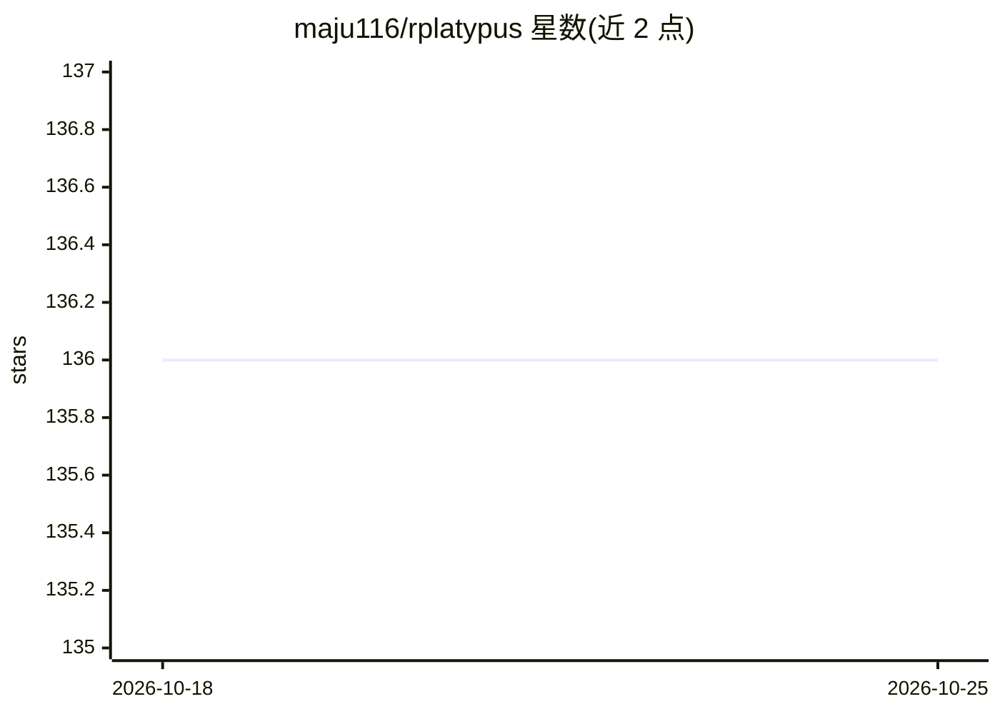

# maju116/rplatypus

⭐ 136 · R · NOASSERTION · 推送 2026-10-24 · [GitHub](https://github.com/maju116/rplatypus) · [官网](https://maju116.github.io/rplatypus/) · 个人维护

**医学影像分割与检测的 R 包：从图片文件夹到出图，2D/3D、DICOM/NIfTI**

面向用 R 做医学影像分析的 R 包，通过 reticulate 在底层安装并隔离 pyplatypus（PyTorch 引擎）完成计算，用户以 R API 调用。提供 U-Net/U-Net++/Res-U-Net/LinkNet 四种分割架构与 YOLOv3 检测，支持 2D 与 3D（NIfTI、DICOM 切片文件夹）、九种损失、按患者切分数据、预测写回原扫描网格、按名称加载已发布权重等。规范可用 R 参数或 YAML 文件表达，两者产出相同对象。作者声明这是 2020 版的重写且处于 alpha 阶段，API 仍会变动。

## 筛选速览

| 维度 | 判定 | 备注 |
|---|---|---|
| AI 角色 | `ai-native` | 本体是模型或模型工具 |
| 许可风险 | `none` | NOASSERTION |
| 部署形态 | `library` | 以包/库形式分发 |
| 模型依赖 | — | README 未给出锁定关系 |
| 硬件要求 | — | 无带数字的原话,不猜 |
| 安装摩擦 | `medium` | 含编译或系统依赖之一 |
| 成熟度 | `idea` | |

## 能力要点

- 分割（U-Net/U-Net++/Res-U-Net/LinkNet）与 YOLOv3 目标检测，2D 与 3D
- 读取 DICOM 与 NIfTI，预测写回原扫描网格并以 NIfTI 输出带几何信息的掩码
- R 参数与 YAML 文件描述同一实验，首次调用自动构建隔离 Python 环境
- 按名称加载已发布权重（如 dsbowl-unet、bccd-yolo3），export_weights 可导出并附训练信息

## 适用场景

- 训练/评估医学影像（MRI 序列、细胞图）的分割或检测模型并可视化结果
- 对 3D 体数据做分割并按毫升报告结构体积
- 复现模型卡报告的实验（vignette 走查 Data Science Bowl、BCCD）

## 场景标签

`目标检测` · 领域:感知与多模态

## 证据(README 行号)

> L3: **Segmentation and object detection for medical images, from a folder of pictures to a
> L4: figure.**
> L10: > TensorFlow through the R keras package. This one runs on PyTorch through
> L11: > pyplatypus, which it installs and isolates for

## 星数曲线

2026-10-18 136 → 2026-10-25 136（+0）

---
*卡片 v1 · prompt 1.4 · 生成 2026-10-22 · 置信度 mid · 依据 README sha `b296566b7aa6` · [字段定义](../../DATASET.md)*
