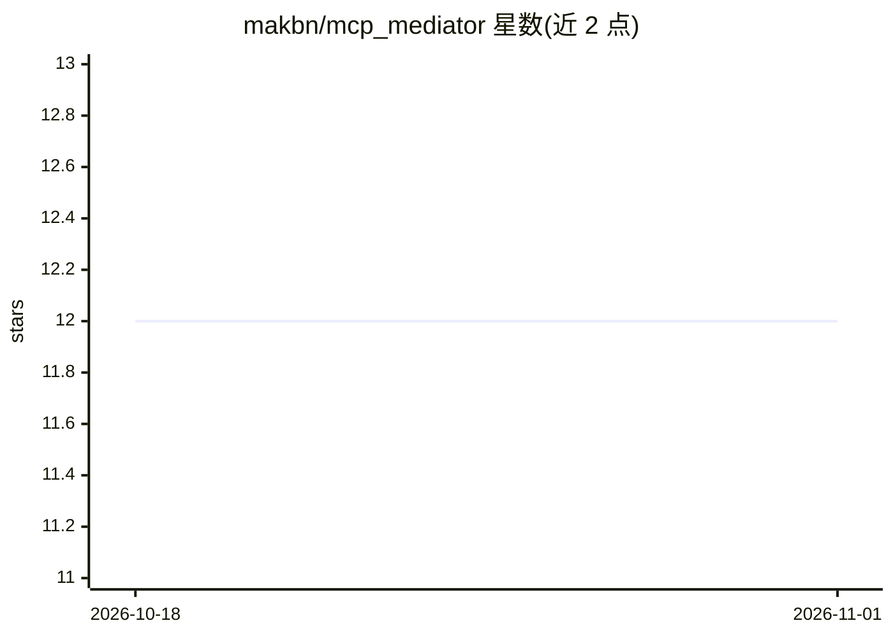

# makbn/mcp_mediator

⭐ 12 · Java · GPL-3.0 · 推送 2026-08-30 · [GitHub](https://github.com/makbn/mcp_mediator) · [官网](https://makbn.github.io/mcp_mediator/) · 个人维护

**从既有 Java 代码自动生成并代理 MCP Server 的 Java 框架**

基于 Java 的 Model Context Protocol 中介框架：通过 @McpService 注解把现有源码、服务类、helper 方法自动生成为 MCP Server 工具，无需改动原代码；同时支持以代理模式聚合多个外部 MCP Server，向 MCP 客户端统一通告可用 Tools。提供 stdio/SSE 传输、Spring Boot 自动配置 starter、Spring Security 集成、OpenTelemetry 观测及自定义错误处理，并内置 Wikipedia/Stackoverflow/GitHub 查询与 Docker、Dropbox 实现模块。要求 Java 17+ 与 Maven 3.6+。

## 筛选速览

| 维度 | 判定 | 备注 |
|---|---|---|
| AI 角色 | `ai-ecosystem` | LLM/agent 周边工具 |
| 许可风险 | `viral` | GPL-3.0 |
| 部署形态 | `None` |  |
| 模型依赖 | — | README 未给出锁定关系 |
| 硬件要求 | — | 无带数字的原话,不猜 |
| 安装摩擦 | `medium` | 含编译或系统依赖之一 |
| 成熟度 | `idea` | |

## 能力要点

- @McpService 注解将既有 Java 方法/服务自动生成为 MCP 工具
- 代理模式聚合多个远程 MCP Server 并统一通告 Tools
- stdio/SSE 传输与 Spring Boot 自动配置 starter
- Spring Security 集成与 OpenTelemetry 观测示例

## 适用场景

- 把现有 Java 服务类和 helper 方法接入 MCP 生态而不改动代码
- 将多个 MCP Server 聚合为单一代理供 MCP 客户端调用
- 为 Spring Boot 应用自动生成端点级 MCP Server

## 场景标签

`Agent 框架` · 领域:Agent 开发

## 证据(README 行号)

> L3: A Java-based implementation of a Model Context Protocol (MCP) mediator that automatically generates an MCP Server fr
> L12: The MCP Mediator implements the Model Context Protocol specification, providing a robust framework for:

## 星数曲线

2026-10-18 12 → 2026-11-01 12（+0）

---
*卡片 v1 · prompt 1.4 · 生成 2026-11-01 · 置信度 high · 依据 README sha `f3364537e385` · [字段定义](../../DATASET.md)*
