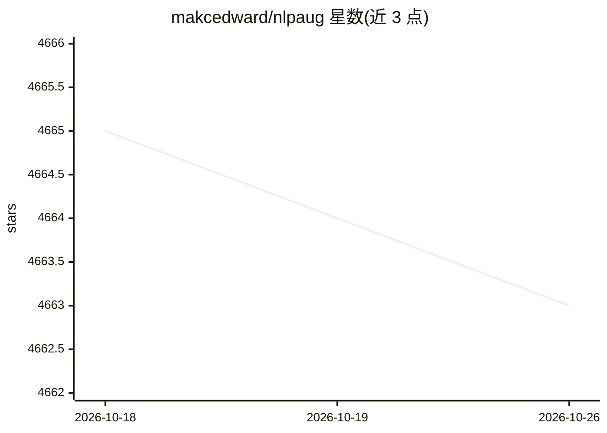

# makcedward/nlpaug

⭐ 4,663 · Jupyter Notebook · MIT · 推送 2026-10-23 · [GitHub](https://github.com/makcedward/nlpaug) · [官网](https://makcedward.github.io/) · 个人维护

**NLP/音频/频谱数据增强的 Python 库**

面向机器学习项目提供合成数据生成的 Python 库：以 Augmenter 为基本单元、Flow 编排流水线，覆盖字符/词/句子级文本增强（如键盘误差、OCR 误差、BERT/XLNet 上下文词替换、回译、TF-IDF、word2vec/GloVe/fastText 嵌入）以及音频与频谱增强（裁剪、噪声、音调、时间/频率掩码等）。通过 pip 安装核心包并按需安装 transformers/nltk/audio 等可选扩展，目标 Python 3.12+，提供离线测试套件与 uv 工作流。

## 筛选速览

| 维度 | 判定 | 备注 |
|---|---|---|
| AI 角色 | `ai-ecosystem` | LLM/agent 周边工具 |
| 许可风险 | `permissive` | MIT |
| 部署形态 | `library` | 以包/库形式分发 |
| 模型依赖 | — | README 未给出锁定关系 |
| 硬件要求 | — | 无带数字的原话,不猜 |
| 安装摩擦 | `low` | 无编译、无系统依赖或容器化 |
| 成熟度 | — | 结构信号不足 |

## 能力要点

- 20+ 文本增强器（字符/词/句子级）与 10+ 音频/频谱增强器
- 支持 BERT、XLNet、GPT2、word2vec、GloVe、fastText 等预训练模型驱动增强
- Flow 流水线（Sequential/Sometimes）编排多个增强器
- 可选扩展安装（transformers/nltk/word-embs/audio/lambada）

## 适用场景

- 为 NLP 模型训练扩充数据集、提升模型表现
- 模拟键盘/OCR/拼写错误测试模型鲁棒性
- 音频与频谱数据的增强预处理

## 场景标签

 · 领域:NLP/机器学习工具库

## 证据(README 行号)

> L13: This python library helps you with augmenting NLP, audio, and spectrogram data for machine learning projects. Visit
> L16: * Generate synthetic data for improving model performance without manual effort

## 星数曲线

2026-10-18 4,665 → 2026-10-26 4,663（-2）

---
*卡片 v1 · prompt 1.4 · 生成 2026-10-20 · 置信度 high · 依据 README sha `0ea77fea596c` · [字段定义](../../DATASET.md)*
