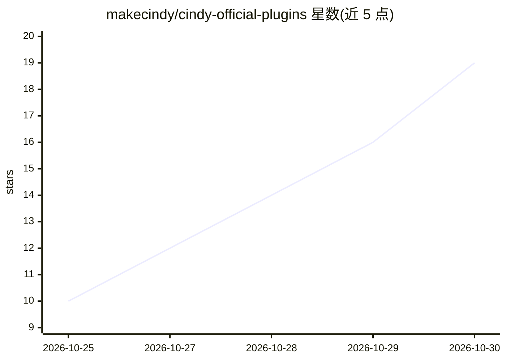

# makecindy/cindy-official-plugins

⭐ 19 · JavaScript · Apache-2.0 · 推送 2026-10-29 · [GitHub](https://github.com/makecindy/cindy-official-plugins) · 组织维护 · 中文 README

**Cindy AI 助手官方插件源码仓：插件源码、审查标准与市场上架**

Cindy 插件市场的官方插件（Ghost）源码仓库，收录 GitHub/GitLab/Gitea、Notion、Gmail 等邮件、Google 办公套件、图像生成、网页搜索等 20 余个插件，用户经 Cindy 客户端一键安装。面向插件贡献者：合并到 main 自动提交至 Global Plugin Platform，经审批后上架；仓库定义准入与受众标准、四项审查原则（沙箱与授权、密钥归属、工具描述即契约、可操作错误信息）与提交前自检清单。普通使用者无需本仓库。

## 筛选速览

| 维度 | 判定 | 备注 |
|---|---|---|
| AI 角色 | `ai-ecosystem` | LLM/agent 周边工具 |
| 许可风险 | `permissive` | Apache-2.0 |
| 部署形态 | `None` |  |
| 模型依赖 | — | README 未给出锁定关系 |
| 硬件要求 | — | 无带数字的原话,不猜 |
| 安装摩擦 | `low` | 无编译、无系统依赖或容器化 |
| 成熟度 | — | 结构信号不足 |

## 能力要点

- 20+ 官方插件源码，覆盖代码托管、邮件、办公套件、图像生成、搜索等
- 合并 main 自动提交插件市场，审批后发布
- 明确的准入/受众标准与四项安全审查原则
- 支持外部贡献：PR、DCO 签核、四语言本地化与 CI 校验

## 适用场景

- 为 Cindy 客户端查找并安装官方插件
- 为 Cindy 平台开发并提交自己的插件
- 了解 Cindy 插件的沙箱、密钥与授权审查规范

## 场景标签

`图像生成` · 领域:内容生成

## 证据(README 行号)

> L14: This is the source for every official plugin (Ghost) in the
> L15: Cindy plugin marketplace.
> L37: ||Plugin|Directory|Description|

## 星数曲线

2026-10-25 10 → 2026-10-30 19（+9）

---
*卡片 v1 · prompt 1.4 · 生成 2026-10-30 · 置信度 high · 依据 README sha `6447de9f73c8` · [字段定义](../../DATASET.md)*
