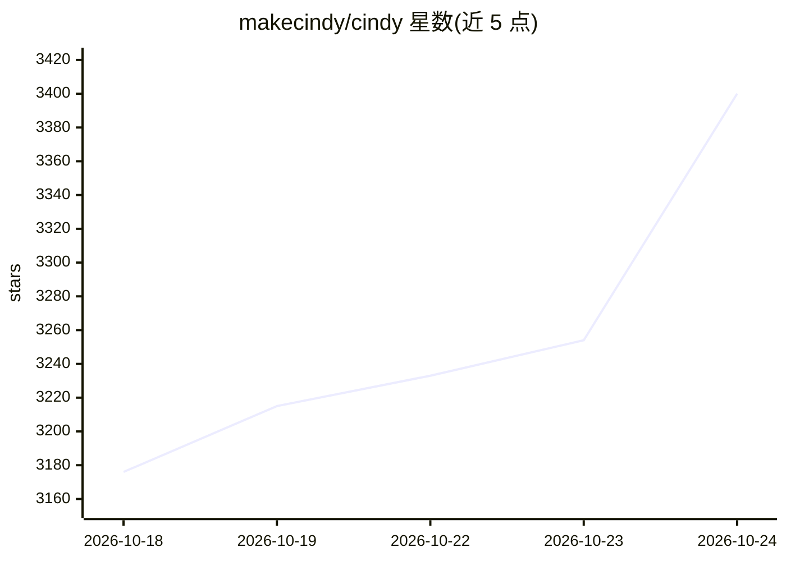

# makecindy/cindy

⭐ 3,920 · TypeScript · Apache-2.0 · 推送 2026-10-24 · [GitHub](https://github.com/makecindy/cindy) · [官网](https://cindy.app) · 组织维护 · 中文 README

**开箱即用的开源 AI Agent 客户端，在本地完成实际工作**

Cindy 是开源的桌面与移动 AI Agent 客户端（Electron + Expo/React Native，pnpm monorepo），把多种 harness（首批支持 Claude Code 与 Codex）与模型整合为一个可完成实际任务的 agent，可在任务中途切换 harness×模型组合。运行在用户本机，可操控浏览器、电脑与手机，支持记忆、技能、自动化、MCP 与插件机制。模型接入方式包括官方云服务、Claude Code/Codex 订阅复用、自有 API key 或本地模型；可选择跳过登录仅用本地 agent。客户端 Apache-2.0 开源，后端服务不在本仓库。

## 筛选速览

| 维度 | 判定 | 备注 |
|---|---|---|
| AI 角色 | `ai-native` | 本体是模型或模型工具 |
| 许可风险 | `permissive` | Apache-2.0 |
| 部署形态 | `library` | 以包/库形式分发 |
| 模型依赖 | — | README 未给出锁定关系 |
| 硬件要求 | — | 无带数字的原话,不猜 |
| 安装摩擦 | `low` | 无编译、无系统依赖或容器化 |
| 成熟度 | — | 结构信号不足 |

## 能力要点

- 整合 Claude Code 与 Codex 等多 harness，模型与 harness 可混用并在任务中切换
- 本地运行，可驱动浏览器、电脑与手机
- 支持记忆、技能、自动化调度、MCP 与插件（SkillHub 安装）
- 可通过官方服务、已有 Coding Plan、自有 API key 或本地模型接入

## 适用场景

- 在桌面和手机上用一个 agent 完成项目中的实际工作
- 复用已付费的 Claude Code / Codex 订阅而不重复计费
- 通过 MCP 把内部工具接入 agent 的能力范围

## 场景标签

`AI 助手` `编码 Agent` · 领域:编码与开发

## 证据(README 行号)

> L12: Cindy is an open-source AI agent that works out of the box. She brings multiple
> L17: apps. The first supported harnesses are **Claude Code** and **Codex** — more are
> L24: This repository is the open-source **client** for Cindy — the desktop and mobile

## 星数曲线

2026-10-18 3,176 → 2026-10-24 3,400（+224）

---
*卡片 v1 · prompt 1.4 · 生成 2026-10-21 · 置信度 mid · 依据 README sha `afa5880c04db` · [字段定义](../../DATASET.md)*
