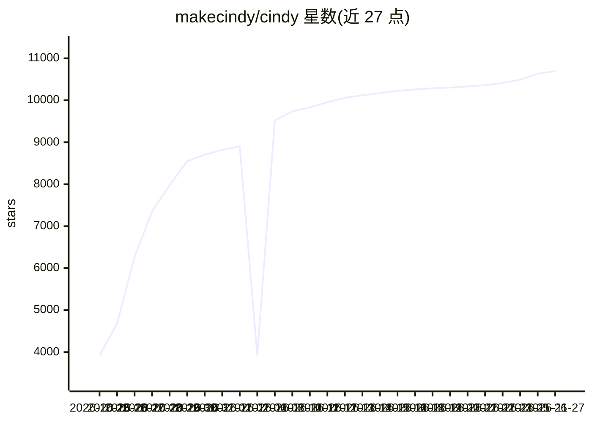

# makecindy/cindy

⭐ 10,696 · TypeScript · Apache-2.0 · 推送 2026-11-26 · [GitHub](https://github.com/makecindy/cindy) · [官网](https://cindy.app) · 组织维护 · 中文 README

**跨设备统一管理多 Agent 与模型的开源桌面/移动客户端**

开源的桌面与移动客户端（Electron + Expo/React Native，pnpm monorepo），把用户已有的电脑与手机连接为一个工作区：会话与文件可跨设备延续，可共享另一台机器上配置的模型订阅/API/本地模型，手机端内置远程桌面操作电脑。统一接入 Claude Code、Codex 与 Pi 三种 harness，提供多 Agent 协作、自动化例行任务、Slack/Telegram 通道、Skills/插件/MCP 扩展与记忆。客户端 Apache-2.0 免费，模型用量按各 provider 计费；默认连接官方云服务，Skip Sign-In 模式仅本地 Agent。

## 筛选速览

| 维度 | 判定 | 备注 |
|---|---|---|
| AI 角色 | `ai-ecosystem` | LLM/agent 周边工具 |
| 许可风险 | `permissive` | Apache-2.0 |
| 部署形态 | `library` | 以包/库形式分发 |
| 模型依赖 | — | README 未给出锁定关系 |
| 硬件要求 | — | 无带数字的原话,不猜 |
| 安装摩擦 | `low` | 无编译、无系统依赖或容器化 |
| 成熟度 | — | 结构信号不足 |

## 能力要点

- 统一接入 Claude Code / Codex / Pi 三种 agent harness，可切换并保留会话
- 跨设备延续会话与文件，共享其他设备上配置的模型与订阅
- 手机端内置远程桌面，直接操作已连接电脑
- 支持 automations、Slack/Telegram 通道与 Skills/plugins/MCP 扩展

## 适用场景

- 在手机上远程查看并继续电脑上正在进行的 Agent 任务
- 把已有的 Claude Code / Codex 订阅接入统一客户端
- 让多个 Agent 分工做规划、并行实现与独立审查
- 把重复工作流固化为自动化或可分享的 Skill

## 场景标签

`多智能体` `编码 Agent` `AI 助手` `工作流自动化` · 领域:Agent 开发

## 证据(README 行号)

> L12: Cindy is an **open-source AI agent, ready out of the box and yours to shape**.
> L41: Already using Claude Code or Codex? Cindy brings them together with **Pi**,
> L127: This repository contains Cindy's open-source **desktop and mobile clients** and

## 星数曲线

2026-10-25 3,920 → 2026-11-27 10,696（+6,776）

---
*卡片 v1 · prompt 1.4 · 生成 2026-11-27 · 置信度 high · 依据 README sha `873284749ee2` · [字段定义](../../DATASET.md)*
