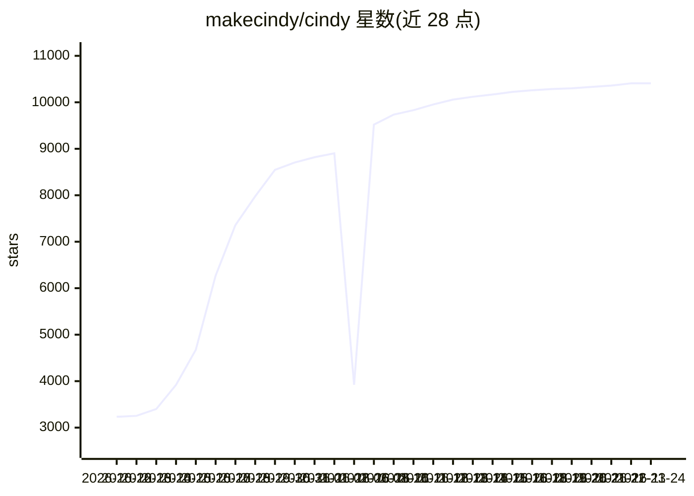

# makecindy/cindy

⭐ 10,494 · TypeScript · Apache-2.0 · 推送 2026-11-24 · [GitHub](https://github.com/makecindy/cindy) · [官网](https://cindy.app) · 组织维护 · 中文 README

**开源开箱即用的 AI Agent 客户端，跨设备统一管理 agent**

Cindy 是一个开源 AI Agent 客户端，包含 Electron 桌面端与 React Native 移动端，以 pnpm monorepo 组织。它将 Claude Code、Codex 与 Pi 三种 agent harness 集成到统一界面下，提供多设备会话延续、跨设备模型提供方共享、手机端远程桌面控制、automations 定时任务、Skills/插件/MCP 扩展与多 agent 协作编排。客户端本身免费并采用 Apache-2.0 许可，默认连接官方云服务，也支持免登录本地模式；官方分发构建含 TapDB 统计，可在设置中关闭。

## 筛选速览

| 维度 | 判定 | 备注 |
|---|---|---|
| AI 角色 | `ai-ecosystem` | LLM/agent 周边工具 |
| 许可风险 | `permissive` | Apache-2.0 |
| 部署形态 | `library` | 以包/库形式分发 |
| 模型依赖 | — | README 未给出锁定关系 |
| 硬件要求 | — | 无带数字的原话,不猜 |
| 安装摩擦 | `low` | 无编译、无系统依赖或容器化 |
| 成熟度 | — | 结构信号不足 |

## 能力要点

- 集成 Claude Code、Codex、Pi 三种 agent harness，可切换并保留会话
- 多设备同一会话延续，跨设备共享模型提供方（订阅/API/本地模型）
- 手机端内置远程桌面可操作连接的电脑，无需自建服务器
- 支持 Skills、插件、MCP 扩展与多 agent 分工协作

## 适用场景

- 在多台电脑与手机之间延续同一个 agent 会话
- 把已有的 Claude Code/Codex 订阅接入统一客户端界面
- 让多个 agent 分别负责规划、实现与独立评审
- 通过 Slack/Telegram 通道或定时任务交接日常工作

## 场景标签

`编码 Agent` `多智能体` `AI 助手` · 领域:Agent 开发

## 证据(README 行号)

> L12: Cindy is an **open-source AI agent, ready out of the box and yours to shape**.
> L41: Already using Claude Code or Codex? Cindy brings them together with **Pi**,
> L109: This repository contains Cindy's open-source **desktop and mobile clients** and

## 星数曲线

2026-10-22 3,233 → 2026-11-24 10,408（+7,175）

---
*卡片 v1 · prompt 1.4 · 生成 2026-11-22 · 置信度 mid · 依据 README sha `469edabc4a47` · [字段定义](../../DATASET.md)*
