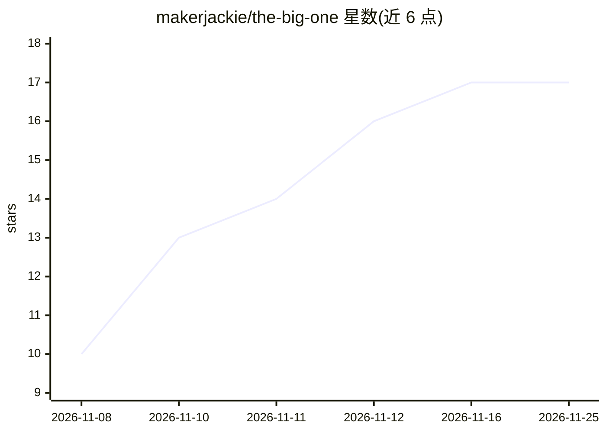

# makerjackie/the-big-one

⭐ 17 · HTML · MIT · 推送 2026-11-05 · [GitHub](https://github.com/makerjackie/the-big-one) · [官网](https://makerjackie.com) · 个人维护 · 中文 README

**由 Claude 编写代码生成的 39 秒动画短片（单 HTML 文件）**

一部完全用代码制作的 39 秒动画短片：无图像模型、视频模型与音频文件，每帧由 three.js 实时渲染，配乐音效用 JavaScript 合成，成品是一个 716 KB 的离线 HTML 文件，浏览器双击即可播放。制作用了 3 个 agent（导演渲染、配乐音效、道具），共约 2 小时。仓库还附中文复盘文档与可复用的制作 prompt，并提供 npm 构建流程与 MP4 渲染工具。

## 筛选速览

| 维度 | 判定 | 备注 |
|---|---|---|
| AI 角色 | `ai-native` | 本体是模型或模型工具 |
| 许可风险 | `permissive` | MIT |
| 部署形态 | `library` | 以包/库形式分发 |
| 模型依赖 | — | README 未给出锁定关系 |
| 硬件要求 | — | 无带数字的原话,不猜 |
| 安装摩擦 | `low` | 无编译、无系统依赖或容器化 |
| 成熟度 | — | 结构信号不足 |

## 能力要点

- 全部内容为代码生成：three.js 渲染 + JavaScript 合成配乐，无任何模型/媒体文件
- 成品为 716 KB 单 HTML 文件，离线播放，支持暂停/跳转/全屏/超采样
- 13 镜头、936 帧、约 5,800 行代码，由 3 个 agent 协作完成
- 附制作复盘 PLAYBOOK.md 与可复用 prompt

## 适用场景

- 直接下载 HTML 文件离线观看这部短片
- 参考 PLAYBOOK 与 prompt 用 Claude Code 制作自己的动画短片
- 学习纯代码动画渲染管线（painterly 后处理、GPU 脊柱蒙皮等）

## 场景标签

`代码生成` · 领域:编码与开发

## 证据(README 行号)

> L5: **A 39-second anime short made 100% in code by Claude Opus 5.5.** No image models, no video models, no audio files: 
> L22: - 3 agents: a director agent (rendering, modeling, animation) plus two in parallel (score & sound, props)

## 星数曲线

2026-11-08 10 → 2026-11-25 17（+7）

---
*卡片 v1 · prompt 1.4 · 生成 2026-11-18 · 置信度 high · 依据 README sha `dedf84795576` · [字段定义](../../DATASET.md)*
