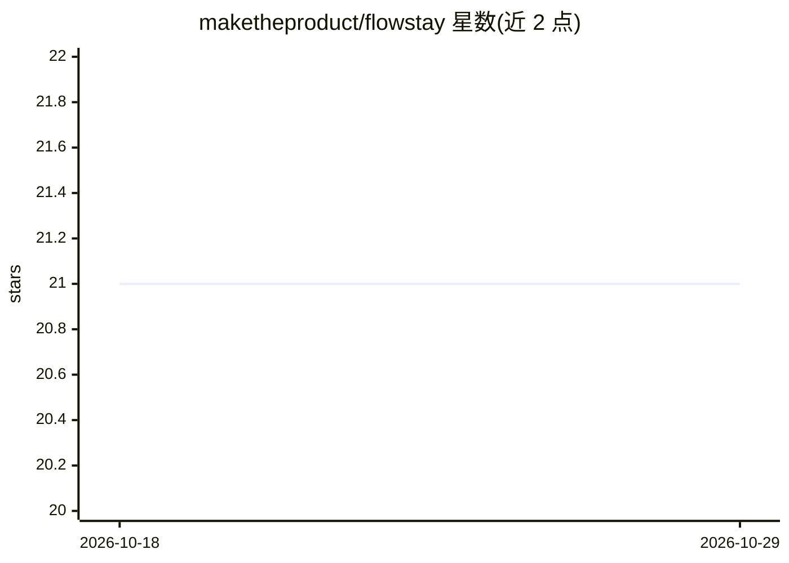

# maketheproduct/flowstay

⭐ 21 · Swift · Apache-2.0 · 推送 2026-10-27 · [GitHub](https://github.com/maketheproduct/flowstay) · [官网](https://flowstay.app) · 组织维护

**macOS 菜单栏语音转写应用：全局快捷键转写并自动粘贴**

基于 FluidAudio 的 macOS 菜单栏应用，提供系统级语音转写：通过 Option+Space 切换或按住说话触发，转写文本自动粘贴到当前应用。Personas 功能支持接入 Apple Intelligence（本机，macOS 26+）、OpenRouter（云端 OAuth）以及本地安装的 Claude Code CLI（沿用其 Claude 订阅或 ANTHROPIC_API_KEY 计费），可重写转写文本或作为助手直接回答。需 macOS 15+，通过 Swift 命令行编译构建，申请麦克风与辅助功能权限。

## 筛选速览

| 维度 | 判定 | 备注 |
|---|---|---|
| AI 角色 | `ai-native` | 本体是模型或模型工具 |
| 许可风险 | `permissive` | Apache-2.0 |
| 部署形态 | `None` |  |
| 模型依赖 | locked-api |  |
| 硬件要求 | — | 无带数字的原话,不猜 |
| 安装摩擦 | `low` | 无编译、无系统依赖或容器化 |
| 成熟度 | `idea` | |

## 能力要点

- 系统级快捷键转写并自动粘贴（Toggle/Hold/Both 三种模式）
- Personas 接入 Apple Intelligence / OpenRouter / 本地 Claude Code CLI
- Claude Code 模式沿用 Claude Pro/Max 订阅会话
- 快捷键设置经 UserDefaults 持久化

## 适用场景

- 在任意应用中用语音输入替代打字
- 用 AI Persona 对转写文本做改写或直接提问
- Mac 上快速记录口述内容

## 场景标签

`语音识别` · 领域:感知与多模态

## 证据(README 行号)

> L5: Flowstay is a macOS menu bar app for fast transcription with smart workflows, running on FluidAudio.
> L65: - Apple Intelligence (on-device, macOS 26+)
> L66: - OpenRouter (cloud, OAuth connection)
> L67: - Claude Code (local CLI integration)

## 星数曲线

2026-10-18 21 → 2026-10-29 21（+0）

---
*卡片 v1 · prompt 1.4 · 生成 2026-10-28 · 置信度 high · 依据 README sha `08859f333a0b` · [字段定义](../../DATASET.md)*
