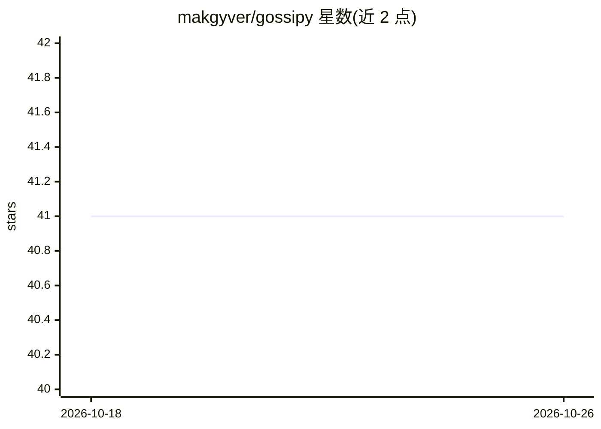

# makgyver/gossipy

⭐ 41 · Python · Apache-2.0 · 推送 2026-03-24 · [GitHub](https://github.com/makgyver/gossipy) · 个人维护

**流言学习与去中心化联邦学习的 Python 仿真模块**

用于仿真 gossip learning 与去中心化联邦学习（DFL）的 Python 库，面向分布式机器学习研究者。实现了多篇文献中的方法（如 Ormandi 2013 的流言线性模型、去中心化 SGD、分段流言等），以 PyPI 包 gossipy-dfl 通过 pip 安装，支持 GPU（标注为 quick fix）。README 以 TODO 清单与参考文献为主，部分方法仅部分实现，文档托管在 GitHub Pages。

## 筛选速览

| 维度 | 判定 | 备注 |
|---|---|---|
| AI 角色 | `ai-ecosystem` | LLM/agent 周边工具 |
| 许可风险 | `permissive` | Apache-2.0 |
| 部署形态 | `library` | 以包/库形式分发 |
| 模型依赖 | — | README 未给出锁定关系 |
| 硬件要求 | — | 无带数字的原话,不猜 |
| 安装摩擦 | `low` | 无编译、无系统依赖或容器化 |
| 成熟度 | `idea` | |

## 能力要点

- 仿真流言学习与去中心化联邦学习算法
- 实现或部分实现多篇论文中的方法（Ormandi 2013、Koloskova 2020、Hegedus 2021 等）
- GPU 支持（README 标注为快速修复）
- 以 pip 包 gossipy-dfl 形式发布，附在线文档

## 适用场景

- 研究去中心化联邦学习与流言学习算法
- 复现相关论文中的学习方法并做仿真实验
- 对比流言学习与联邦学习的经验表现

## 场景标签

`科研工具` · 领域:学习与行业

## 证据(README 行号)

> L13: Python module for simulating gossip learning and decentralized federated learning.
> L29: - [ ] Models cache[[Ormandi 2013]](#1) [[Giaretta 2019]](#4) (partially implemented)

## 星数曲线

2026-10-18 41 → 2026-10-26 41（+0）

---
*卡片 v1 · prompt 1.4 · 生成 2026-10-25 · 置信度 high · 依据 README sha `b0a88e673ab5` · [字段定义](../../DATASET.md)*
