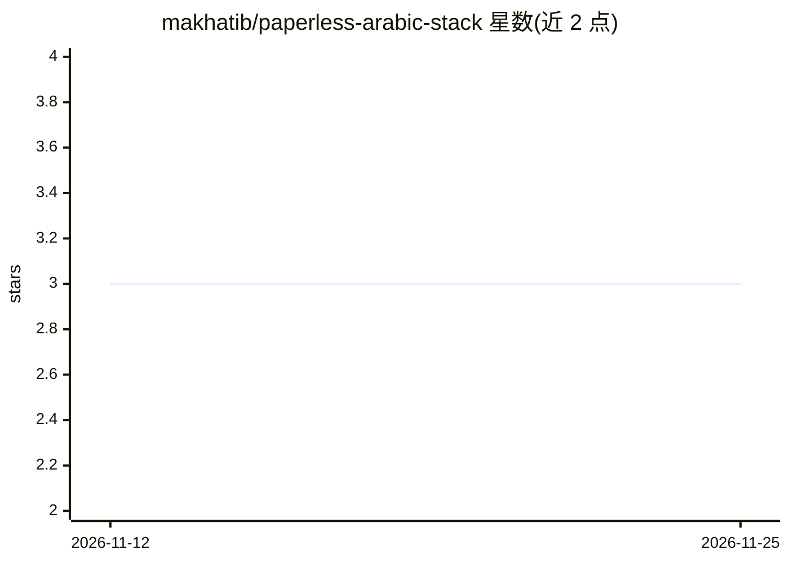

# makhatib/paperless-arabic-stack

⭐ 3 · Shell · MIT · 推送 2026-10-30 · [GitHub](https://github.com/makhatib/paperless-arabic-stack) · 个人维护

**一键安装面向阿拉伯语文档的 Paperless-ngx + GPT 归档栈**

安装脚本将 Paperless-ngx 与 Paperless-GPT 组合部署为 Docker Compose 栈，针对阿拉伯语场景配置：用视觉模型读取手机照片/扫描件的阿拉伯语文字，并自动填写标题、发件人、日期和标签；通过四个文档标签触发 AI 审批、自动保存或重新 OCR。支持本地 Ollama 模型（CPU/GPU）或云 API 后端，内置 Authentik OIDC 认证、Traefik HTTPS（HomeLab 本地 CA / VPS Let's Encrypt）、备份与已验证的恢复流程。README 列出 7 项已知限制（RTL 数字排序、自动标签重复等）。

## 筛选速览

| 维度 | 判定 | 备注 |
|---|---|---|
| AI 角色 | `ai-native` | 本体是模型或模型工具 |
| 许可风险 | `permissive` | MIT |
| 部署形态 | `self-host` | docker 或自建部署 |
| 模型依赖 | local-ok | 支持本地模型 |
| 硬件要求 | `cpu-ok` | |
| 安装摩擦 | `low` | 无编译、无系统依赖或容器化 |
| 成熟度 | — | 结构信号不足 |

## 能力要点

- 一条命令安装完整栈：Paperless-ngx、Paperless-GPT、Ollama、Authentik、Traefik 等 9 个服务
- 四个标签驱动 AI 流程：人工审批、自动保存、视觉模型重读、失败标记
- 支持本地（qwen3:8b / qwen2.5vl:7b）与云后端（OpenRouter / Google API），模型可在 .env 更换
- 备份包含身份、OIDC 密钥、CA 状态与双数据库，update 前强制安全备份

## 适用场景

- 把阿拉伯语手机拍照的发票/信件/收据归档为可搜索档案
- 自托管环境下让 AI 自动填写文档元数据
- HomeLab 或 VPS 部署带认证与 HTTPS 的文档管理系统

## 场景标签

`OCR` `文档解析` · 领域:知识与检索

## 证据(README 行号)

> L5: Your paper invoices, letters and receipts become a searchable archive. An AI model
> L83: Paperless-GPT watches for tags. Put a tag on a document in Paperless-ngx and the AI
> L249: |paperless-gpt|`icereed/paperless-gpt:v0.29.0`|the AI layer|

## 星数曲线

2026-11-12 3 → 2026-11-25 3（+0）

---
*卡片 v1 · prompt 1.4 · 生成 2026-11-21 · 置信度 high · 依据 README sha `08db19f5ead6` · [字段定义](../../DATASET.md)*
