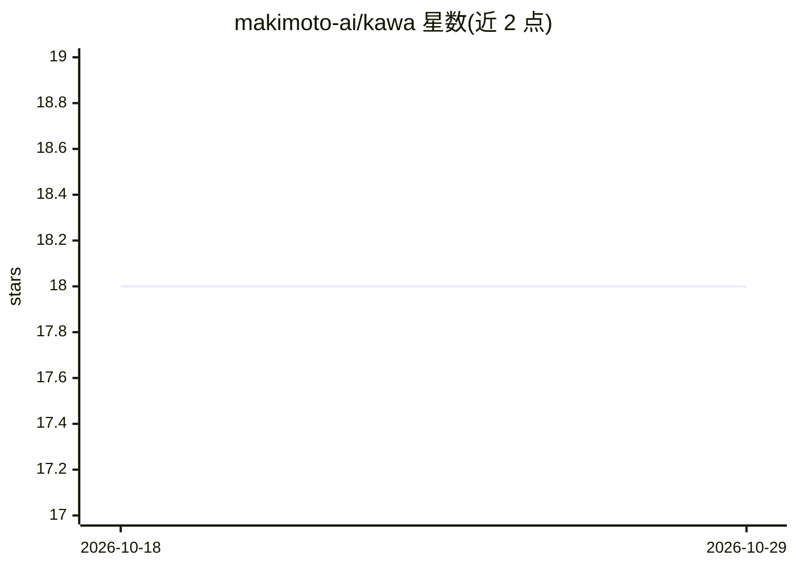

# makimoto-ai/kawa

⭐ 18 · Python · MIT · 推送 2026-10-21 · [GitHub](https://github.com/makimoto-ai/kawa) · [官网](https://www.makimoto.ai/) · 组织维护

**新加坡托管的亚太多语言语音转文字转录 API**

Makimoto 公司运营的托管转录服务：提交录音后轮询作业，返回带说话人分离与分段时间戳的转写文本，并可对转写结果做摘要或打标签。管道分五阶段（重采样、VAD 与说话人分离、降噪、语音识别、后处理），各阶段可替换。音频与转写数据留存新加坡，面向受 PDPA/MAS 等合规约束的团队。以 REST API 与 Python SDK（pip 安装）形式提供，每月含 1,000 分钟免费额度；实时 API 与自托管管道在路线图中尚未发布。

## 筛选速览

| 维度 | 判定 | 备注 |
|---|---|---|
| AI 角色 | `ai-native` | 本体是模型或模型工具 |
| 许可风险 | `permissive` | MIT |
| 部署形态 | `library` | 以包/库形式分发 |
| 模型依赖 | — | README 未给出锁定关系 |
| 硬件要求 | — | 无带数字的原话,不猜 |
| 安装摩擦 | `low` | 无编译、无系统依赖或容器化 |
| 成熟度 | — | 结构信号不足 |

## 能力要点

- 转录结果含说话人分离与分段级时间戳
- 支持转写后摘要与打标签端点
- 数据留存新加坡，面向 APAC 数据驻留与监管需求
- 官方 Python SDK 内置轮询、错误处理与配额检查

## 适用场景

- 对通话录音、语音留言做带说话人分离的转写
- 合规要求下对客户交互录音做归档分析
- 在 APAC 数据驻留约束下接入语音转写 API

## 场景标签

`语音识别` · 领域:感知与多模态

## 证据(README 行号)

> L12: **Kawa is live.** Makimoto Kawa is the first open-source conversational AI infrastructure built and hosted in Singa
> L64: Submit a recording, poll the job, then read the transcript with speaker separation and segment-level timestamps. A 

## 星数曲线

2026-10-18 18 → 2026-10-29 18（+0）

---
*卡片 v1 · prompt 1.4 · 生成 2026-10-29 · 置信度 high · 依据 README sha `829203aa3bcc` · [字段定义](../../DATASET.md)*
