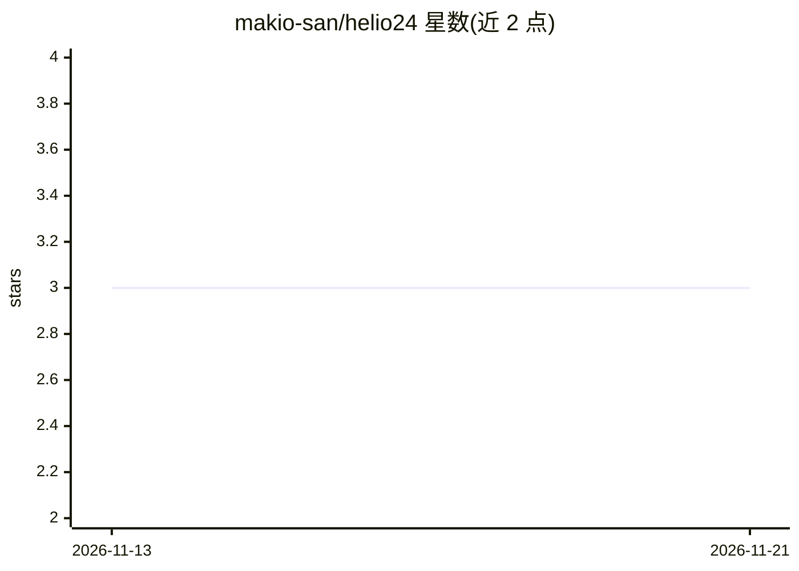

# makio-san/helio24

⭐ 3 · Python · 推送 2026-11-16 · [GitHub](https://github.com/makio-san/helio24) · 个人维护

**科研原型：预测太阳活动区 24 小时内是否爆发 M/X 级耀斑**

基于 SWAN-SF 数据集的研究原型，用 XGBoost 等模型估计太阳活动区在 24 小时内产生 M 级或 X 级耀斑的概率。面向太阳物理/空间天气研究者，核心机制包括预注册实验协议、防泄漏的时间划分评估（按分区划分训练/校准/测试，不随机切分）、概率校准与基于 HARP 区域的不确定性区间，并提供本地 Streamlit 仪表盘回放预测与审计事件标签。报告以英文和土耳其文双语发布。明确声明为历史数据研究，不估计对卫星或地球的实际影响。

## 筛选速览

| 维度 | 判定 | 备注 |
|---|---|---|
| AI 角色 | `ai-native` | 本体是模型或模型工具 |
| 许可风险 | `none` | — |
| 部署形态 | `library` | 以包/库形式分发 |
| 模型依赖 | — | README 未给出锁定关系 |
| 硬件要求 | — | 无带数字的原话,不猜 |
| 安装摩擦 | `low` | 无编译、无系统依赖或容器化 |
| 成熟度 | — | 结构信号不足 |

## 能力要点

- 预注册实验协议与防泄漏评估（清除重叠窗口与共享 HARP ID）
- 概率校准、召回率目标与 1,000 次 whole-HARP bootstrap 不确定性区间
- 本地 Streamlit 仪表盘支持预测回放、阈值探索与实验进度监控
- 英文/土耳其文双语研究报告，发布时校验哈希与数值一致性

## 适用场景

- 复现或扩展预注册的太阳耀斑预测实验
- 在防泄漏的时间划分上评估耀斑概率模型
- 用仪表盘回放历史预测并审计标签与警报期

## 场景标签

`科研工具` · 领域:学习与行业

## 证据(README 行号)

> L3: A research prototype for estimating whether a solar active region will produce
> L4: an M- or X-class flare within the next 24 hours.
> L40: Source: SWAN-SF on Harvard Dataverse.

## 星数曲线

2026-11-13 3 → 2026-11-21 3（+0）

---
*卡片 v1 · prompt 1.4 · 生成 2026-11-21 · 置信度 high · 依据 README sha `3cdb9712ee6a` · [字段定义](../../DATASET.md)*
