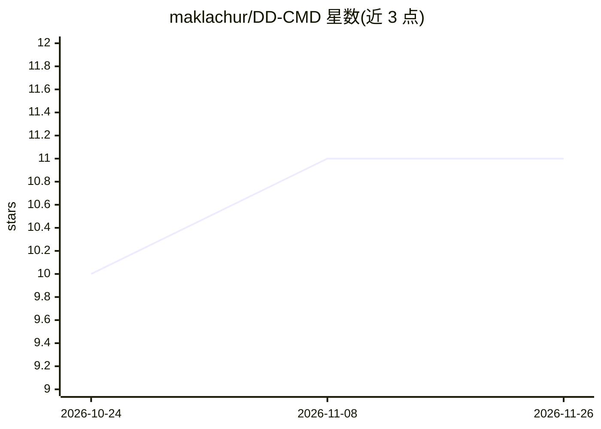

# maklachur/DD-CMD

⭐ 11 · Python · 推送 2026-08-13 · [GitHub](https://github.com/maklachur/DD-CMD) · [官网](https://arxiv.org/abs/2608.11335) · 个人维护

**临床文本引导的医学图像分割模型实现**

DD-CMD 是 MICCAI 2026 论文的官方实现，围绕双域跨模态解码构建，以临床文本为条件输入生成医学图像分割结果。仓库提供 conda 环境与 requirements.txt 安装、QaTa-COV19 与 MosMedData+ 两个数据集的准备说明、ConvNeXt-Tiny 与 PubMedBERT 预训练骨干下载指引、PyTorch Lightning 训练脚本及按数据集的评估命令。预训练 checkpoint 尚未公开，需联系作者获取以复现。

## 筛选速览

| 维度 | 判定 | 备注 |
|---|---|---|
| AI 角色 | `ai-native` | 本体是模型或模型工具 |
| 许可风险 | `none` | — |
| 部署形态 | `library` | 以包/库形式分发 |
| 模型依赖 | — | README 未给出锁定关系 |
| 硬件要求 | — | 无带数字的原话,不猜 |
| 安装摩擦 | `low` | 无编译、无系统依赖或容器化 |
| 成熟度 | — | 结构信号不足 |

## 能力要点

- 双域跨模态解码，融合临床文本与医学图像
- 基于 ConvNeXt-Tiny 视觉骨干与 PubMedBERT 语言骨干
- 提供 QaTa-COV19 与 MosMedData+ 两个数据集的训练与评估流程
- PyTorch Lightning 训练，config/train.yaml 集中配置

## 适用场景

- 复现论文中文本引导的新冠 CT 肺部影像分割实验
- 在自己的标注数据上训练文本条件分割模型
- 医学影像研究中的多模态分割基线搭建

## 场景标签

`多模态` `目标检测` · 领域:感知与多模态

## 证据(README 行号)

> L3: **Dual-Domain Cross-Modal Decoding for Clinical Text-Guided Medical Image Segmentation (DD-CMD)** has been accepted 
> L30: The text annotations for **QaTa-COV19** and **MosMedData+** can be obtained from the related resources provided in 

## 星数曲线

2026-10-24 10 → 2026-11-26 11（+1）

---
*卡片 v1 · prompt 1.4 · 生成 2026-11-18 · 置信度 high · 依据 README sha `8a354b9962ac` · [字段定义](../../DATASET.md)*
