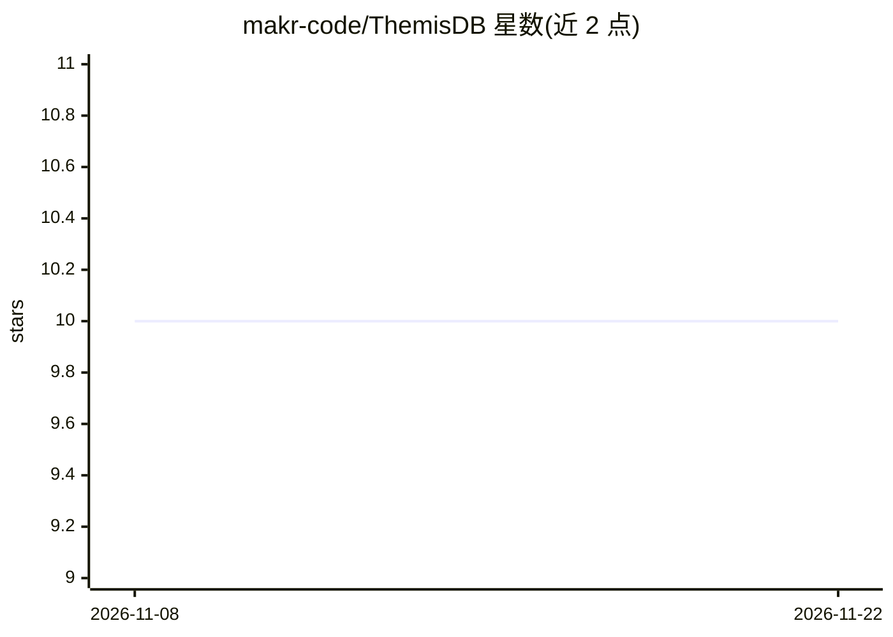

# makr-code/ThemisDB

⭐ 10 · C++ · NOASSERTION · 推送 2026-11-21 · [GitHub](https://github.com/makr-code/ThemisDB) · [官网](https:\\www.themisdb.org) · 组织维护

**C++ 多模型数据库：图/向量/关系/文档等多负载统一存储**

以 C++ 实现的多模型数据库项目，宣称覆盖关系、文档、图、向量、地理空间与时序等工作负载，提供 AQL、全文与向量检索及混合检索，含 ACID 事务、复制、分片与恢复流程，并带推理与检索增强生成的集成能力。README 自述为概览而非状态来源，功能可用性按模块与版本而异，需查 ROADMAP.md 与发布门禁确认。从源码构建，依赖 SETUP.md 的引导与 CMakePresets.json 预设；项目在 Kickstarter 众筹。

## 筛选速览

| 维度 | 判定 | 备注 |
|---|---|---|
| AI 角色 | `ai-enhanced` | 去掉 AI 部分产品仍成立 |
| 许可风险 | `none` | NOASSERTION |
| 部署形态 | `None` |  |
| 模型依赖 | — | README 未给出锁定关系 |
| 硬件要求 | — | 无带数字的原话,不猜 |
| 安装摩擦 | `medium` | 含编译或系统依赖之一 |
| 成熟度 | — | 结构信号不足 |

## 能力要点

- 多模型数据负载：关系、文档、图、向量、地理空间、时序
- AQL 查询与全文/向量混合检索
- ACID 事务、复制、分片与恢复流程
- AI/LLM 推理与检索增强生成集成

## 适用场景

- 同一数据库内管理图、向量、关系等多种数据模型
- 为检索增强生成应用提供向量检索后端
- 需要 ACID 事务与多版本并发的多模型存储场景

## 场景标签

`向量数据库` · 领域:知识与检索

## 证据(README 行号)

> L34: |Multi-model data|Relational, document, graph, vector, geospatial, and time-series workloads|
> L37: |AI/LLM|Inference and retrieval-augmented generation integrations|
> L46: 2. Development Setup — build environment and canonical CMake presets.

## 星数曲线

2026-11-08 10 → 2026-11-22 10（+0）

---
*卡片 v1 · prompt 1.4 · 生成 2026-11-19 · 置信度 mid · 依据 README sha `2ccb49f9dc59` · [字段定义](../../DATASET.md)*
