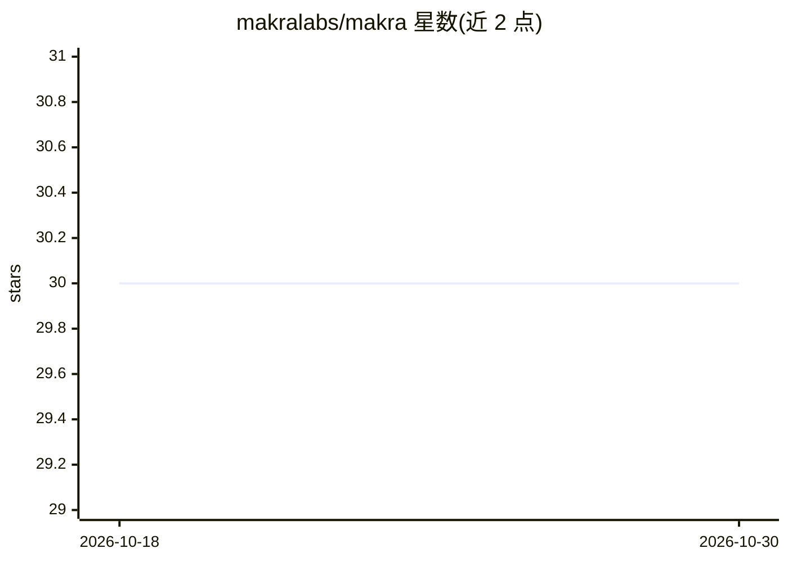

# makralabs/makra

⭐ 30 · Python · MIT · 推送 2026-08-29 · [GitHub](https://github.com/makralabs/makra) · [官网](https://www.makralabs.org) · 组织维护

**Makra 网页数据抽取 API 的官方 SDK（Python/JS）**

为 Makra 网页抽取 API 提供 Python 与 JavaScript SDK：传入 URL 和字段描述（schema），由远端读取页面并返回结构化 JSON，不拆包 data 字段、不施加响应模型。支持同步请求、流式生命周期事件与可跨进程的延迟任务（RunHandle 的 wait/stream/result/cancel）。仓库含双语言 SDK、语言中立契约 SPEC.md 与本地网关 playground。需设置 MAKRA_API_KEY；本地开发可用开发 API key 与 localhost 网关。

## 筛选速览

| 维度 | 判定 | 备注 |
|---|---|---|
| AI 角色 | `ai-ecosystem` | LLM/agent 周边工具 |
| 许可风险 | `permissive` | MIT |
| 部署形态 | `library` | 以包/库形式分发 |
| 模型依赖 | — | README 未给出锁定关系 |
| 硬件要求 | — | 无带数字的原话,不猜 |
| 安装摩擦 | `low` | 无编译、无系统依赖或容器化 |
| 成熟度 | — | 结构信号不足 |

## 能力要点

- Python 与 JavaScript 双 SDK，共享 SPEC.md 契约
- 三种工作流：同步 extract、SSE 流式、跨进程延迟任务 RunHandle
- schema 驱动：字段描述即抽取需求，重复内容用对象模板列表
- 附带本地网关 playground（默认 localhost:8080）

## 适用场景

- 让 AI agent 按需从网页读取结构化数据
- 先运行 schema 探查页面再设计抽取结构
- 把抽取任务 ID 存入自己的任务记录并跨进程取结果

## 场景标签

`网页抓取` · 领域:效率与自动化

## 证据(README 行号)

> L13: Makra is the official client for the Makra web extraction API. Pass a URL and a small description of the data you n
> L15: This repository contains the Python and JavaScript SDKs, their shared contract, and a Python playground for a local

## 星数曲线

2026-10-18 30 → 2026-10-30 30（+0）

---
*卡片 v1 · prompt 1.4 · 生成 2026-10-26 · 置信度 mid · 依据 README sha `b54bcf4a0520` · [字段定义](../../DATASET.md)*
