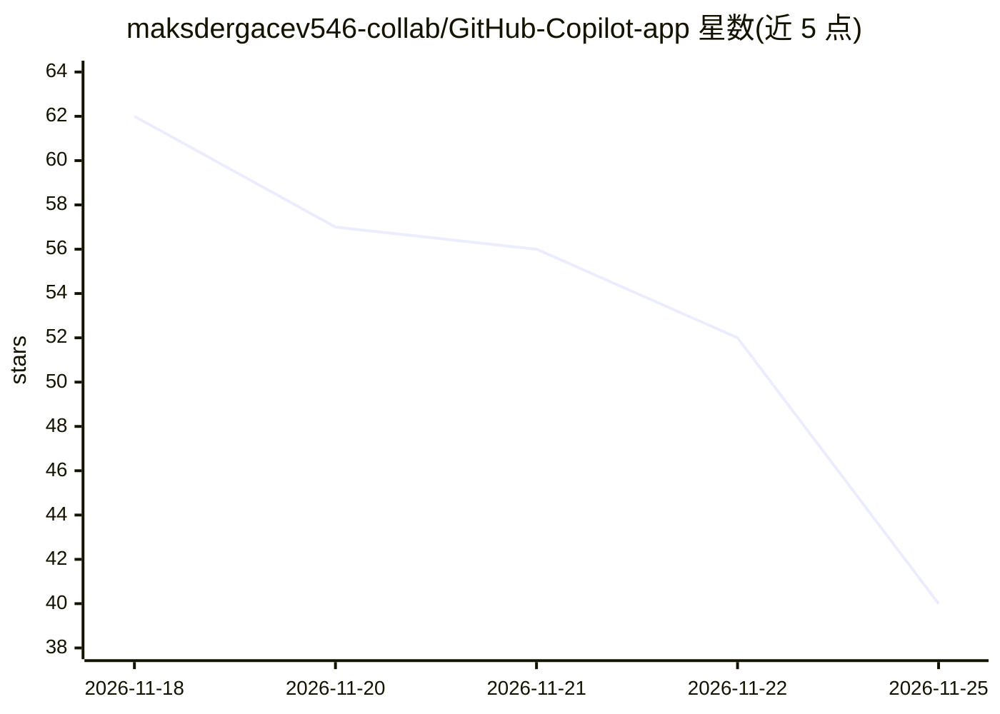

# maksdergacev546-collab/GitHub-Copilot-app

⭐ 40 · Apache-2.0 · 推送 2026-11-17 · [GitHub](https://github.com/maksdergacev546-collab/GitHub-Copilot-app) · 组织维护

**面向开发者的 GitHub Copilot agent 桌面端工作管理应用**

GitHub 官方发布的桌面应用，定位为 agent-native 的软件工作管理体验：统一查找待办工作、启动与引导 Copilot agent 会话、通过 Canvas 面板查看与编辑 agent 的计划/终端/diff，并管理 issue 与 pull request 直至合并。本地会话运行在隔离的 git worktree，云端会话运行于 GitHub 托管环境；另含自动化定时任务与 Agent Merge 功能。前置条件为 Git 与任一 Copilot 订阅（或自带模型 key）。通过 Releases 页面下载安装。

## 筛选速览

| 维度 | 判定 | 备注 |
|---|---|---|
| AI 角色 | `ai-ecosystem` | LLM/agent 周边工具 |
| 许可风险 | `permissive` | Apache-2.0 |
| 部署形态 | `desktop` | 安装包/桌面程序 |
| 模型依赖 | — | README 未给出锁定关系 |
| 硬件要求 | — | 无带数字的原话,不猜 |
| 安装摩擦 | `low` | 无编译、无系统依赖或容器化 |
| 成熟度 | — | 结构信号不足 |

## 能力要点

- 本地会话运行于隔离 git worktree，支持并行 agent 开发
- Canvas 面板集中展示 agent 计划、终端、diff 与工作流状态
- My Work 聚合 sessions、issues、pull requests 与仓库上下文
- 支持 BYOK 自带模型 key，无 Copilot 订阅也可使用

## 适用场景

- 并行让多个 Copilot agent 分别调查 bug、实现 issue、处理评审意见
- 在一个桌面端管理跨仓库的 issue、会话与 pull request
- 把重复性提示词设为定时或后台自动化任务

## 场景标签

`编码 Agent` · 领域:编码与开发

## 证据(README 行号)

> L13: The GitHub Copilot app is an agent-native desktop experience for managing software work from idea to pull request. 
> L15: The app is built for parallel agent-driven development. Each local session runs in its own isolated git worktree, a
> L76: © GitHub, Inc. All rights reserved.

## 星数曲线

2026-11-18 62 → 2026-11-25 40（-22）

---
*卡片 v1 · prompt 1.4 · 生成 2026-11-18 · 置信度 mid · 依据 README sha `ef82cf6db0cd` · [字段定义](../../DATASET.md)*
