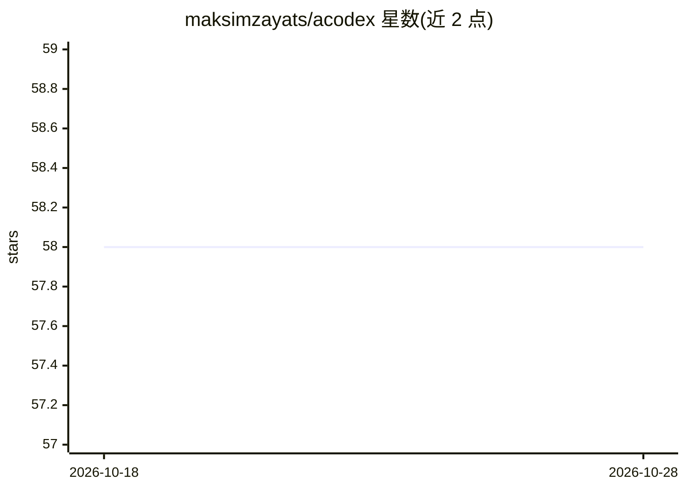

# maksimzayats/acodex

⭐ 58 · Python · MIT · 推送 2026-10-26 · [GitHub](https://github.com/maksimzayats/acodex) · [官网](http://docs.acodex.dev/) · 个人维护

**macOS 上连接 Codex 桌面应用的本地 MCP 自动化桥接工具**

面向 Codex 桌面应用用户的本地自动化桥：通过 Chrome DevTools Protocol 端点接入运行中的 Codex 桌面会话，可重启 Codex 开启 CDP 端口、运行托管 HTTP/MCP 服务器，并在 /mcp 端点暴露 codex_app.* 工具供本地自动化客户端调用。提供 CLI 用于配置检查、工具列举与调用。限制：需 Python 3.10+、uv 与 macOS 上的 Codex.app；状态变更的工具调用会直接作用于活动的桌面应用。

## 筛选速览

| 维度 | 判定 | 备注 |
|---|---|---|
| AI 角色 | `ai-ecosystem` | LLM/agent 周边工具 |
| 许可风险 | `permissive` | MIT |
| 部署形态 | `None` |  |
| 模型依赖 | — | README 未给出锁定关系 |
| 硬件要求 | — | 无带数字的原话,不猜 |
| 安装摩擦 | `low` | 无编译、无系统依赖或容器化 |
| 成熟度 | — | 结构信号不足 |

## 能力要点

- 通过 CDP 端点接入运行中的 Codex 桌面会话并调用 codex_app.* 工具
- 在 /mcp 端点暴露 MCP 兼容的本地服务器
- CLI 支持配置管理、深度诊断（doctor --deep）与 JSON 输出的工具调用

## 适用场景

- 让脚本或 agent 自动化操作 Codex 桌面应用的会话与工具
- 通过 MCP 客户端调用 Codex 桌面暴露的本地工具
- 从终端检查配置并诊断桥接连接状态

## 场景标签

`GUI 自动化` · 领域:效率与自动化

## 证据(README 行号)

> L5: **Local MCP automation for the Codex desktop app.**
> L18: - **MCP-compatible local server.** Expose Codex desktop tools at `/mcp` for
> L19:  local automation clients.

## 星数曲线

2026-10-18 58 → 2026-10-28 58（+0）

---
*卡片 v1 · prompt 1.4 · 生成 2026-10-24 · 置信度 high · 依据 README sha `0c45cb364db7` · [字段定义](../../DATASET.md)*
