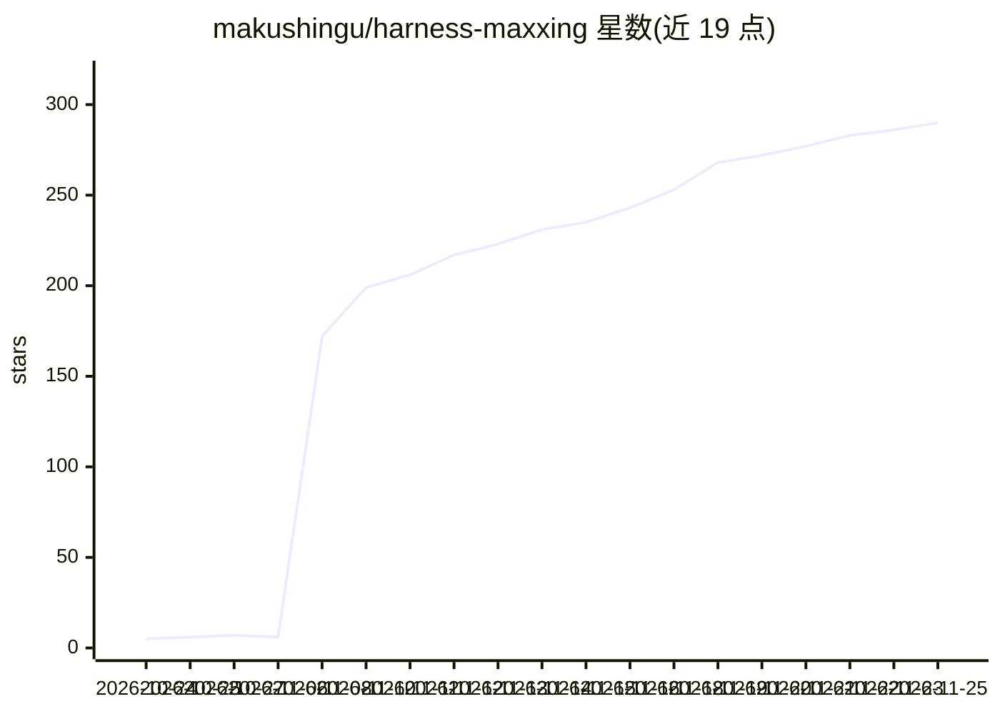

# makushingu/harness-maxxing

⭐ 290 · Python · NOASSERTION · 推送 2026-11-24 · [GitHub](https://github.com/makushingu/harness-maxxing) · [官网](https://harness-maxxing.com) · 个人维护

**自托管的 Claude Code Web 控制台：会话/定时任务/Telegram**

部署在自己服务器上的 Claude Code 网页控制台，以项目→主题→会话的结构管理多个持久化对话，提供流式输出、工具调用卡片、diff 查看、文件管理、定时任务、Telegram 网关、语音转录（本地 Whisper 或 Groq/OpenAI）与每日记忆备份。可选模块包括邮件客户端、多代理协作、服务器浏览器与设备控制。通过一条 curl 命令在 Ubuntu VPS 上安装，需要 Claude 订阅或 Anthropic API key。许可证为 Fair Source（source-available，非 OSI 开源），企业用途可另购 Enterprise 许可。

## 筛选速览

| 维度 | 判定 | 备注 |
|---|---|---|
| AI 角色 | `ai-ecosystem` | LLM/agent 周边工具 |
| 许可风险 | `none` | NOASSERTION |
| 部署形态 | `None` |  |
| 模型依赖 | — | README 未给出锁定关系 |
| 硬件要求 | — | 无带数字的原话,不猜 |
| 安装摩擦 | `low` | 无编译、无系统依赖或容器化 |
| 成熟度 | — | 结构信号不足 |

## 能力要点

- 项目→主题→多持久会话的组织方式，支持流式输出与工具调用卡片
- 内置 Telegram 网关与定时任务（crons），支持语音消息转录
- 每日记忆备份推送到私有 GitHub 仓库并支持一键恢复
- 安装器以 pinned 版本+校验和方式下载第三方依赖

## 适用场景

- 在自有服务器上集中管理多个 Claude Code 会话
- 通过 Telegram 手机端继续桌面上的对话
- 给 Claude 设置定时任务并接收运行报告

## 场景标签

`编码 Agent` · 领域:编码与开发

## 证据(README 行号)

> L8: **A self-hosted control room for Claude Code.** Many persistent Claude conversations organised by
> L94: - A Claude subscription (Pro, Max or Ultra, connected with `claude setup-token`) or an Anthropic API key.
> L159: Harness Maxxing is published under the Harness Maxxing Fair Source License, a source-available license

## 星数曲线

2026-10-24 5 → 2026-11-25 290（+285）

---
*卡片 v1 · prompt 1.4 · 生成 2026-11-25 · 置信度 high · 依据 README sha `41ba7b5c1c85` · [字段定义](../../DATASET.md)*
