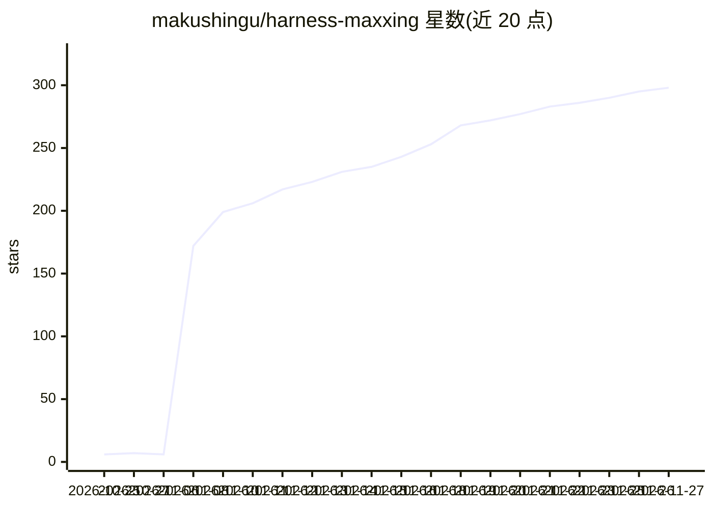

# makushingu/harness-maxxing

⭐ 298 · Python · NOASSERTION · 推送 2026-11-26 · [GitHub](https://github.com/makushingu/harness-maxxing) · [官网](https://harness-maxxing.com) · 个人维护

**自托管的 Claude Code 网页控制台：会话、记忆、定时任务、Telegram**

部署在自己服务器上的 Claude Code 管理面板，以 FastAPI + React 构成。核心机制：按项目/主题组织的持久化会话（流式输出、工具调用卡片、diff、消息队列）、自动维护的 CLAUDE.md 记忆、定时 cron 任务、内置 Telegram 网关与语音转写、每日记忆备份到私有 GitHub 仓库。可选模块包括文件浏览器、邮件客户端、团队聊天、常驻 Agent、浏览器操控、设备操控与 webhook 自动化。需 Ubuntu 服务器、root 权限与 Claude 订阅或 API key，一条 curl 命令安装。许可证为 Fair Source（source-available，非 OSI 开源）。

## 筛选速览

| 维度 | 判定 | 备注 |
|---|---|---|
| AI 角色 | `ai-ecosystem` | LLM/agent 周边工具 |
| 许可风险 | `none` | NOASSERTION |
| 部署形态 | `None` |  |
| 模型依赖 | locked-api |  |
| 硬件要求 | — | 无带数字的原话,不猜 |
| 安装摩擦 | `low` | 无编译、无系统依赖或容器化 |
| 成熟度 | — | 结构信号不足 |

## 能力要点

- 项目→主题→多会话的持久化 Claude 会话管理，含成本与上下文仪表
- CLAUDE.md + memory.md 三级记忆自动加载与备份恢复
- 内置 Telegram 网关：每会话一线程，支持语音笔记转写（本地 Whisper 或 Groq/OpenAI）
- 可选购模块：Agent、cron、webhook、浏览器/设备操控、邮件与团队聊天

## 适用场景

- 在浏览器和 Telegram 里统一管理多个长期 Claude 会话
- 定时运行 Claude 任务并在 Telegram 收取报告
- 让 Claude 以固定角色长期运行（写手、订单处理、监控）
- 从服务器浏览器操控无 API 的网站

## 场景标签

`编码 Agent` `浏览器自动化` · 领域:效率与自动化

## 证据(README 行号)

> L8: **A self-hosted control room for Claude Code.** Many persistent Claude conversations organised by
> L79: - **Claude Code stays current** - the server updates the CLI by itself, only while nothing runs.

## 星数曲线

2026-10-25 6 → 2026-11-27 298（+292）

---
*卡片 v1 · prompt 1.4 · 生成 2026-11-26 · 置信度 high · 依据 README sha `a176a660bf74` · [字段定义](../../DATASET.md)*
