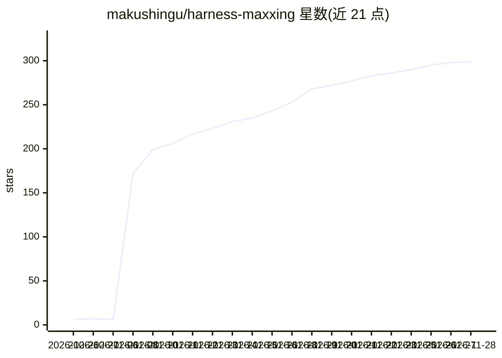

# makushingu/harness-maxxing

⭐ 299 · Python · NOASSERTION · 推送 2026-11-27 · [GitHub](https://github.com/makushingu/harness-maxxing) · [官网](https://harness-maxxing.com) · 个人维护

**自托管的 Claude Code 控制室：持久会话、记忆、定时任务与 Telegram**

部署在自己服务器上的 Web 控制室，管理多个按项目/主题组织的持久 Claude Code 会话，附记忆文件、角色化 agents、定时任务、Webhook 通知流、Telegram 网关与语音转写。通过官方 Claude Code CLI 使用用户自己的 Claude 订阅或 API key，凭据留在本地服务器。安装脚本一条命令完成，需 root 的 Ubuntu/Debian 服务器（建议 2 vCPU/4GB RAM/40GB 磁盘），Fair Source 许可，企业许可可选。

## 筛选速览

| 维度 | 判定 | 备注 |
|---|---|---|
| AI 角色 | `ai-ecosystem` | LLM/agent 周边工具 |
| 许可风险 | `none` | NOASSERTION |
| 部署形态 | `None` |  |
| 模型依赖 | — | README 未给出锁定关系 |
| 硬件要求 | — | 无带数字的原话,不猜 |
| 安装摩擦 | `low` | 无编译、无系统依赖或容器化 |
| 成熟度 | — | 结构信号不足 |

## 能力要点

- 按项目/主题组织的持久会话，支持手机/Telegram 续接
- 分层自动加载的 CLAUDE.md + memory.md 记忆与每日备份到 GitHub 私库
- 带角色、记忆与每日预算的 agents，可由日程/Webhook/通知触发
- 服务器端 Whisper 语音转写（可选 Groq/OpenAI）与 Telegram 会话桥

## 适用场景

- 在自己服务器上长期运行多个 Claude Code 会话
- 通过 Telegram 在手机上继续和监控 Claude 任务
- 给不同角色配置带预算和审批的自动化 agents
- 定时任务与 Webhook 事件驱动的自动化工作流

## 场景标签

`编码 Agent` `工作流自动化` `语音识别` · 领域:效率与自动化

## 证据(README 行号)

> L19: **A self-hosted control room for Claude Code.** Many persistent Claude conversations organised by
> L40: - **Your server, your account.** It runs the official Claude Code CLI with your own Claude subscription or API key;
> L117: - **Claude Code stays current** - the server updates the CLI by itself, only while nothing runs.

## 星数曲线

2026-10-26 6 → 2026-11-28 299（+293）

---
*卡片 v1 · prompt 1.4 · 生成 2026-11-28 · 置信度 high · 依据 README sha `1fa5ec6290ed` · [字段定义](../../DATASET.md)*
