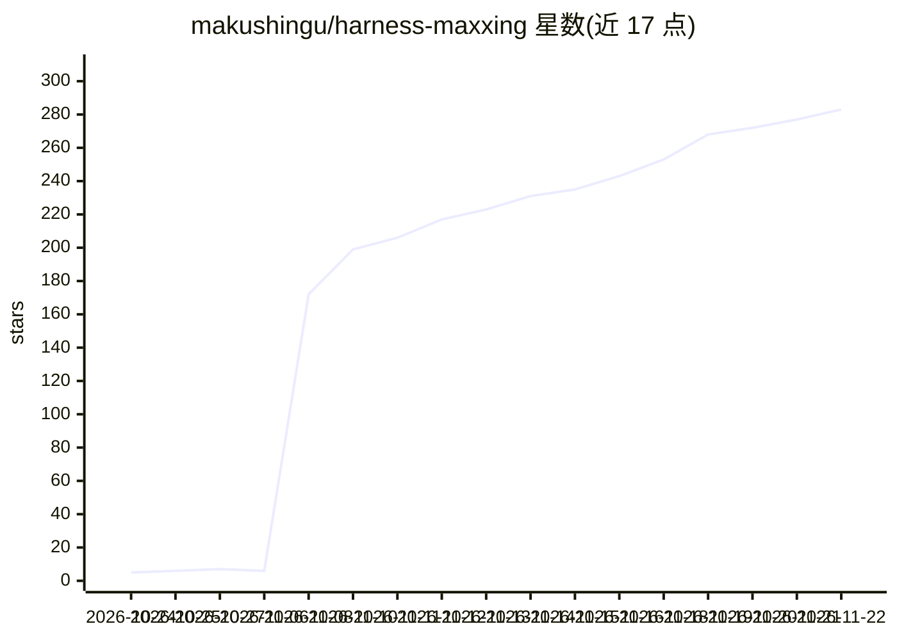

# makushingu/harness-maxxing

⭐ 283 · Python · NOASSERTION · 推送 2026-11-21 · [GitHub](https://github.com/makushingu/harness-maxxing) · [官网](https://harness-maxxing.com) · 个人维护

**自托管的 Claude Code 网页控制室：会话、记忆、定时任务与 Telegram**

部署在用户自有 VPS 上的 Claude Code 管理界面：按项目/主题组织多个持久会话（流式输出、工具调用卡片、diff 查看）、自动加载的分层记忆文件、文件管理与定时任务，可选 Telegram 网关、语音转写（本地 Whisper 或 Groq/OpenAI）、服务端 Chromium 浏览器代理、邮件客户端与多 agent 协作。通过一条 curl 脚本安装（克隆仓库、装依赖、配 Caddy HTTPS、防火墙加固），需 Ubuntu VPS 与 Claude 订阅或 Anthropic API key。采用 Fair Source 许可，企业多实体或付费托管需另行商业授权。

## 筛选速览

| 维度 | 判定 | 备注 |
|---|---|---|
| AI 角色 | `ai-ecosystem` | LLM/agent 周边工具 |
| 许可风险 | `none` | NOASSERTION |
| 部署形态 | `None` |  |
| 模型依赖 | locked-api |  |
| 硬件要求 | — | 无带数字的原话,不猜 |
| 安装摩擦 | `low` | 无编译、无系统依赖或容器化 |
| 成熟度 | — | 结构信号不足 |

## 能力要点

- 项目→主题→多持久会话的组织与流式管理，含 diff/终端/成本上下文计量
- Telegram 内置网关：每会话一线程，支持语音与文件
- 一键安装脚本完成依赖、HTTPS（Caddy）、防火墙与 fail2ban 加固
- 本地 Whisper 语音转写，内存按工作区/项目/主题分层自动加载

## 适用场景

- 在自己的服务器上集中管理多个 Claude Code 长期会话
- 通过 Telegram 远程继续会话并接收定时任务报告
- 让常驻 agent 按计划/webhook 处理订单、监控等事务

## 场景标签

`编码 Agent` `AI 助手` · 领域:编码与开发

## 证据(README 行号)

> L8: **A self-hosted control room for Claude Code.** Many persistent Claude conversations organised by
> L88: - A Claude subscription (Pro, Max or Ultra, connected with `claude setup-token`) or an Anthropic API key.

## 星数曲线

2026-10-24 5 → 2026-11-22 283（+278）

---
*卡片 v1 · prompt 1.4 · 生成 2026-11-17 · 置信度 high · 依据 README sha `09e9e5e2948a` · [字段定义](../../DATASET.md)*
