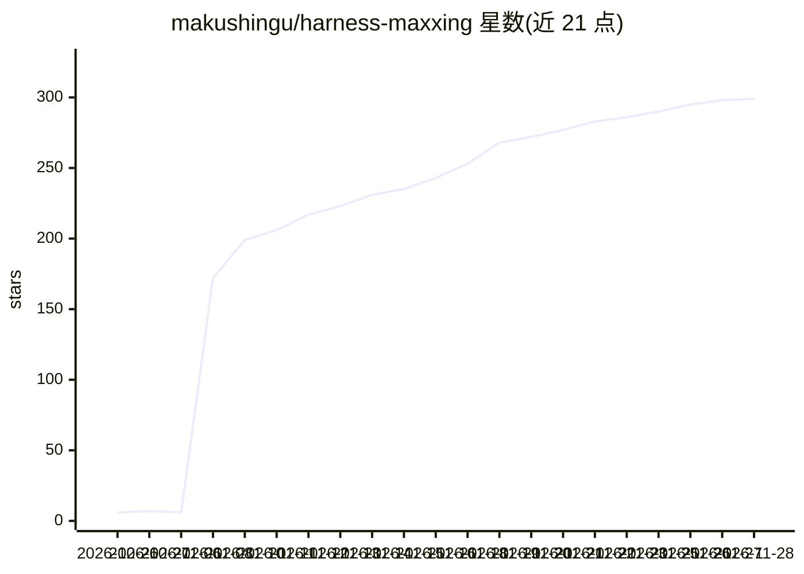

# makushingu/harness-maxxing

⭐ 299 · Python · NOASSERTION · 推送 2026-11-27 · [GitHub](https://github.com/makushingu/harness-maxxing) · [官网](https://harness-maxxing.com) · 个人维护

**自托管的 Claude Code 控制台：持久会话、定时任务与 Telegram**

部署在自己服务器上的 Web 控制台，运行官方 Claude Code CLI：按项目/主题组织多个持久会话，提供分级记忆文件、定时任务、带预算的 agent、文件管理、git diff/提交按钮、Telegram 网关、服务器端语音转录、通知 feed 与每日记忆备份。安装脚本一条命令完成并加固服务器。要求用户自有 Claude 订阅或 API key，源码以 Fair Source 许可提供，企业可选购买许可证。

## 筛选速览

| 维度 | 判定 | 备注 |
|---|---|---|
| AI 角色 | `ai-ecosystem` | LLM/agent 周边工具 |
| 许可风险 | `none` | NOASSERTION |
| 部署形态 | `None` |  |
| 模型依赖 | locked-api |  |
| 硬件要求 | — | 无带数字的原话,不猜 |
| 安装摩擦 | `low` | 无编译、无系统依赖或容器化 |
| 成熟度 | — | 结构信号不足 |

## 能力要点

- 项目→主题→多持久会话的 Web 界面，支持手机与 Telegram 续接
- workspace/项目/主题三级 CLAUDE.md 与 memory.md 自动加载
- 定时 cron、带角色与日预算的 agent、webhook 事件自动化
- 每日记忆备份推送至私有 GitHub 仓库，支持一键恢复迁移

## 适用场景

- 在服务器上长期挂多个 Claude Code 会话，手机上继续对话
- 定时让 agent 执行脚本或提示词并接收 Telegram 报告
- 把 Stripe/Shopify/GitHub 事件接入通知 feed 并触发自动化

## 场景标签

`编码 Agent` `工作流自动化` · 领域:效率与自动化

## 证据(README 行号)

> L19: **A self-hosted control room for Claude Code.** Many persistent Claude conversations organised by
> L40: - **Your server, your account.** It runs the official Claude Code CLI with your own Claude subscription or API key;

## 星数曲线

2026-10-26 6 → 2026-11-28 299（+293）

---
*卡片 v1 · prompt 1.4 · 生成 2026-11-27 · 置信度 high · 依据 README sha `ad64cf8c47e5` · [字段定义](../../DATASET.md)*
