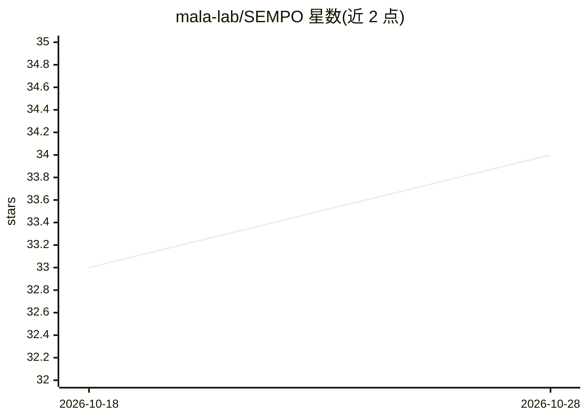

# mala-lab/SEMPO

⭐ 34 · Python · Apache-2.0 · 推送 2026-05-02 · [GitHub](https://github.com/mala-lab/SEMPO) · 组织维护

**轻量级时间序列预测基础模型，面向科研复现与下游预测**

NeurIPS 2025 论文的官方实现，提供时间序列预测基础模型 SEMPO：由能量感知频谱分解模块与混合 Prompt Transformer 组成，通过小规模数据集专属 Prompt 与 token 路由做参数高效适配，以较小的预训练规模和模型尺寸运行。仓库支持预训练、少样本微调（5%/10%）与零样本评估三类脚本，附带单 GPU 预训练检查点，并可下载其他基础模型（如 Chronos-Bolt）权重用同一流程做零样本对比评估。预训练数据（UTSD numpy 格式）需从 Google Drive 自行下载。

## 筛选速览

| 维度 | 判定 | 备注 |
|---|---|---|
| AI 角色 | `ai-native` | 本体是模型或模型工具 |
| 许可风险 | `permissive` | Apache-2.0 |
| 部署形态 | `library` | 以包/库形式分发 |
| 模型依赖 | — | README 未给出锁定关系 |
| 硬件要求 | — | 无带数字的原话,不猜 |
| 安装摩擦 | `medium` | 含编译或系统依赖之一 |
| 成熟度 | — | 结构信号不足 |

## 能力要点

- 预训练/少样本微调/零样本评估三类脚本
- 附带单 GPU 预训练检查点
- 支持在同一流程中评估 Chronos-Bolt 等其他基础模型
- 能量感知频谱分解 + 混合 Prompt Transformer 两模块结构

## 适用场景

- 复现论文中的时间序列预测实验
- 在自有数据集上少样本微调做预测
- 零样本评估并与其他时序基础模型对比

## 场景标签

`微调` `模型训练` · 领域:训练与推理

## 证据(README 行号)

> L5: SEMPO is a novel time series foundation model with significantly reduced model size and pre-training scale, yet demo
> L15: > This work proposes SEMPO, a novel lightweight foundation model that requires pretraining on relatively small-scal
> L34: bash ./scripts/time_series_forecasting/pretrain/sempo_utsd.sh

## 星数曲线

2026-10-18 33 → 2026-10-28 34（+1）

---
*卡片 v1 · prompt 1.4 · 生成 2026-10-25 · 置信度 high · 依据 README sha `66d11b647e54` · [字段定义](../../DATASET.md)*
