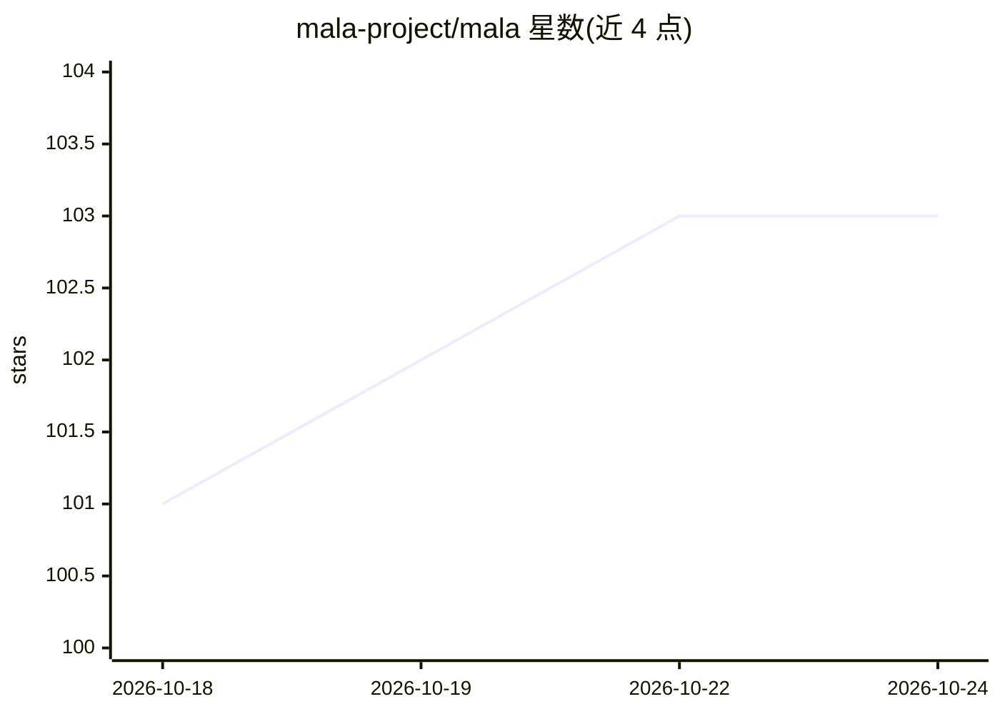

# mala-project/mala

⭐ 103 · Python · BSD-3-Clause · 推送 2026-01-05 · [GitHub](https://github.com/mala-project/mala) · [官网](https://mala-project.github.io/mala/) · 组织维护

**用机器学习生成 DFT 代理模型的材料模拟框架**

MALA 是一个开源 Python 包，基于第一性原理数据训练机器学习代理模型，替代密度泛函理论（DFT）计算中代价高的步骤，以支撑多尺度建模。由 Sandia 国家实验室与 CASUS 联合开发，采用模块化设计，用户可用少量代码完成整个建模工具链。仓库含示例、安装脚本、测试与 Sphinx 文档；可通过 PyPI 安装，但 QuantumESPRESSO 绑定等外部模块不随 PyPI 分发，需查阅完整安装说明。

## 筛选速览

| 维度 | 判定 | 备注 |
|---|---|---|
| AI 角色 | `ai-native` | 本体是模型或模型工具 |
| 许可风险 | `permissive` | BSD-3-Clause |
| 部署形态 | `library` | 以包/库形式分发 |
| 模型依赖 | — | README 未给出锁定关系 |
| 硬件要求 | — | 无带数字的原话,不猜 |
| 安装摩擦 | `low` | 无编译、无系统依赖或容器化 |
| 成熟度 | — | 结构信号不足 |

## 能力要点

- 基于机器学习生成 DFT 计算的代理模型
- 模块化设计，少量代码完成完整建模工具链
- 提供 examples、install 脚本与 Sphinx 文档

## 适用场景

- 材料科学研究中用 ML 代理加速电子结构计算
- 多尺度原子模拟中绕过昂贵的 DFT 步骤
- 基于第一性原理数据训练材料性质预测模型

## 场景标签

`模型训练` · 领域:训练与推理

## 证据(README 行号)

> L10: MALA (Materials Learning Algorithms) is a data-driven framework to generate surrogate models of density functional 
> L12: MALA is designed as a modular and open-source python package. It enables users to perform the entire modeling toolc

## 星数曲线

2026-10-18 101 → 2026-10-24 103（+2）

---
*卡片 v1 · prompt 1.4 · 生成 2026-10-23 · 置信度 high · 依据 README sha `703277119773` · [字段定义](../../DATASET.md)*
