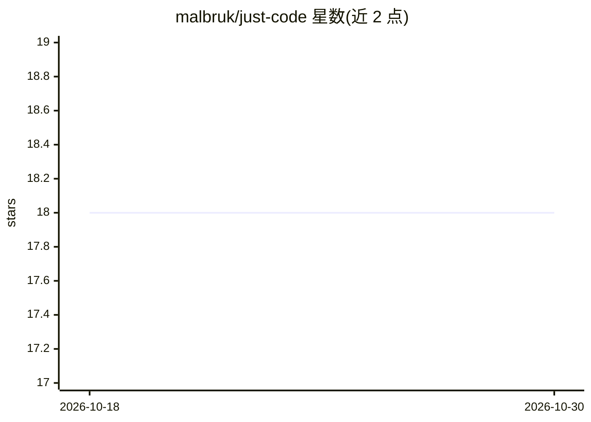

# malbruk/just-code

⭐ 18 · TypeScript · NOASSERTION · 推送 2026-09-17 · [GitHub](https://github.com/malbruk/just-code) · [官网](https://malbruk.github.io/just-code/) · 个人维护

**基于 Claude Agent SDK 的 VS Code 专用编码聊天扩展**

构建于 Anthropic 官方 Claude Agent SDK 之上的 VS Code 扩展，在活动栏提供 agentic 聊天面板，可读取、搜索、编辑和运行工作区代码，包含 SDK 全量工具集、流式响应、工具卡片、权限确认、内联 diff 审阅、检查点与会话历史。特色是范围策略：向系统提示追加约十行纯文本规则，将助手限定于代码与相关技术主题，拒绝其他话题；策略文件可读可改。需本机已安装 Claude Code 运行时（不打包，约 250 MB），支持 API key 或 Claude 订阅两种认证，凭据不离开本机。面向希望编码助手而非通用聊天机器人的开发者与团队。

## 筛选速览

| 维度 | 判定 | 备注 |
|---|---|---|
| AI 角色 | `ai-native` | 本体是模型或模型工具 |
| 许可风险 | `none` | NOASSERTION |
| 部署形态 | `library` | 以包/库形式分发 |
| 模型依赖 | locked-api |  |
| 硬件要求 | — | 无带数字的原话,不猜 |
| 安装摩擦 | `low` | 无编译、无系统依赖或容器化 |
| 成熟度 | — | 结构信号不足 |

## 能力要点

- 提供 SDK 全量工具集（Read/Write/Edit/Bash/Grep/Glob/Web/子代理等）的聊天面板
- 可审计的范围策略文件限定助手只处理软件工程话题
- 权限模式（default/acceptEdits/plan/bypassPermissions）与每次工具调用确认
- 支持 API key 与 Claude 订阅（OAuth）两种本地认证

## 适用场景

- 在编辑器内通过对话让 agent 读写和重构代码
- 团队需要限定 AI 助手只做开发、拒绝闲聊场景
- 审阅并逐条接受/回滚 AI 生成的文件修改

## 场景标签

`编码 Agent` · 领域:编码与开发

## 证据(README 行号)

> L5: **Just Code** is a VS Code extension for agentic software development, built on
> L7: It provides a chat panel that can read, search, edit, and run code in your workspace —

## 星数曲线

2026-10-18 18 → 2026-10-30 18（+0）

---
*卡片 v1 · prompt 1.4 · 生成 2026-10-29 · 置信度 high · 依据 README sha `d4fe5e08b483` · [字段定义](../../DATASET.md)*
