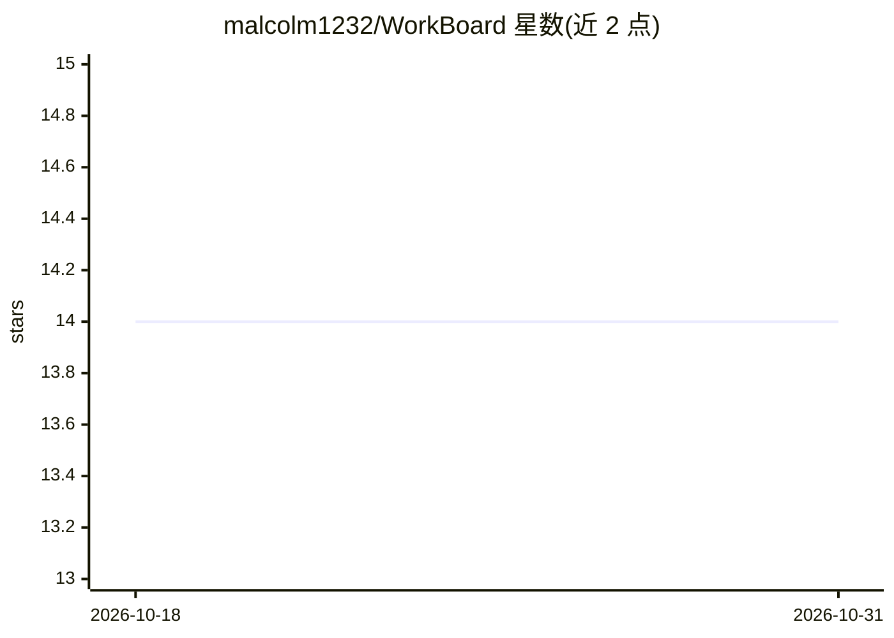

# malcolm1232/WorkBoard

⭐ 14 · Python · NOASSERTION · 推送 2026-10-30 · [GitHub](https://github.com/malcolm1232/WorkBoard) · 个人维护

**Claude Code 的可视化看板插件：人与 agent 共用的任务/知识图谱**

安装于 Claude Code 内的看板插件：任务以卡片形式捕获，随 Claude 工作状态自动在 Task/In Progress/Done 列间移动，卡片挂载子任务、标签、优先级、关联文件与卡片、完成 writeup，形成可被 agent 遍历的知识图谱以低成本回忆历史工作。支持标签过滤、日历视图、bug 回流历史保留、Telegram 手机捕获、新项目自动建板。每个项目一个 board.json 文件，本地运行，无账号无云端；Python 3.9+ 标准库实现，可选 History Replay 引导使用 Claude Haiku 一次性调用。

## 筛选速览

| 维度 | 判定 | 备注 |
|---|---|---|
| AI 角色 | `ai-ecosystem` | LLM/agent 周边工具 |
| 许可风险 | `none` | NOASSERTION |
| 部署形态 | `library` | 以包/库形式分发 |
| 模型依赖 | locked-api |  |
| 硬件要求 | — | 无带数字的原话,不猜 |
| 安装摩擦 | `low` | 无编译、无系统依赖或容器化 |
| 成熟度 | — | 结构信号不足 |

## 能力要点

- 卡片随 Claude 工作状态自动在看板列间移动，含子任务实时进度（如 2/4）
- 卡片构成知识图谱：agent 先读 title 再按需遍历叶子节点，降低召回 token
- ship→bug→fix→ship 全程历史保留，支持链式指令（Do #426, #123）
- Telegram 机器人捕获想法，本地每 15 分钟轮询，无服务器

## 适用场景

- 在 Claude Code 开发中实时查看 agent 正在做什么
- 跨项目积累可检索的工作记录，低成本回答'之前做了什么'
- 用手机随时把想法记入对应项目的看板

## 场景标签

`Agent 记忆` `知识图谱` · 领域:Agent 开发

## 证据(README 行号)

> L13: Install from the plugin marketplace inside Claude Code:
> L36: |1|**Agent memory is for the agent only — invisible to you.**|WorkBoard is a **visual knowledge-graph for both user
> L37: |2|We **can't keep track of our code**.|WorkBoard **tracks live what Claude is working on** and what it just shippe

## 星数曲线

2026-10-18 14 → 2026-10-31 14（+0）

---
*卡片 v1 · prompt 1.4 · 生成 2026-10-31 · 置信度 mid · 依据 README sha `505a7735364d` · [字段定义](../../DATASET.md)*
