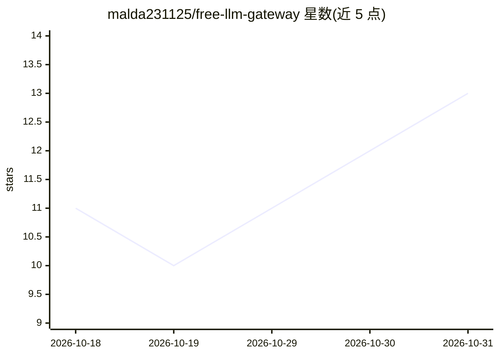

# malda231125/free-llm-gateway

⭐ 13 · TypeScript · 推送 2026-10-28 · [GitHub](https://github.com/malda231125/free-llm-gateway) · 个人维护 · 中文 README

**为开发者聚合 7 家免费 LLM API 并按提示词智能路由的网关**

OpenAI 兼容的 LLM 网关，聚合 Google、Groq、Cerebras、Mistral、NVIDIA NIM、OpenRouter、GitHub Models 七家免费层 API。核心机制是用 Gemini Flash-Lite 读取每个请求的提示词，从 200+ 免费模型目录中选出最合适的 provider/model，失败时按静态优先级回退。支持流式输出、多 key 池化、基于 SQLite 审计日志的请求与 token 配额持久追踪、429 冷却。提供 /v1/generate、/v1/chat/completions、/v1/embeddings 等端点，附带 Next.js 聊天前端。通过 npm 或 Docker Compose 本地部署，README 还列出多种免费托管方案。

## 筛选速览

| 维度 | 判定 | 备注 |
|---|---|---|
| AI 角色 | `ai-ecosystem` | LLM/agent 周边工具 |
| 许可风险 | `permissive` | — |
| 部署形态 | `self-host` | docker 或自建部署 |
| 模型依赖 | locked-api |  |
| 硬件要求 | — | 无带数字的原话,不猜 |
| 安装摩擦 | `low` | 无编译、无系统依赖或容器化 |
| 成熟度 | — | 结构信号不足 |

## 能力要点

- AI 路由按提示词内容在 200+ 免费模型中选择 provider/model
- SQLite 审计日志实现请求与 token 配额追踪，重启后保留
- 多 key 池化：按 key 轮换、单 key 429 冷却不影响池内其他 key
- OpenAI 兼容端点 /v1/chat/completions，支持流式与自动路由

## 适用场景

- 把多家免费 LLM API 聚合成一个 OpenAI 兼容端点给自己的应用调用
- 在免费配额内通过多 key 池化提升可用请求量
- 为不同类型任务自动分派到速度或能力合适的免费模型

## 场景标签

`模型网关` · 领域:Agent 开发

## 证据(README 行号)

> L10: Most free-tier aggregators rotate keys by *quota*. This gateway routes by **what your prompt actually needs**: a fa
> L106: `POST /v1/chat/completions` speaks the standard OpenAI protocol — multi-turn `messages`, `temperature`, `stream`, 

## 星数曲线

2026-10-18 11 → 2026-10-31 13（+2）

---
*卡片 v1 · prompt 1.4 · 生成 2026-10-31 · 置信度 high · 依据 README sha `b81cb44b048f` · [字段定义](../../DATASET.md)*
