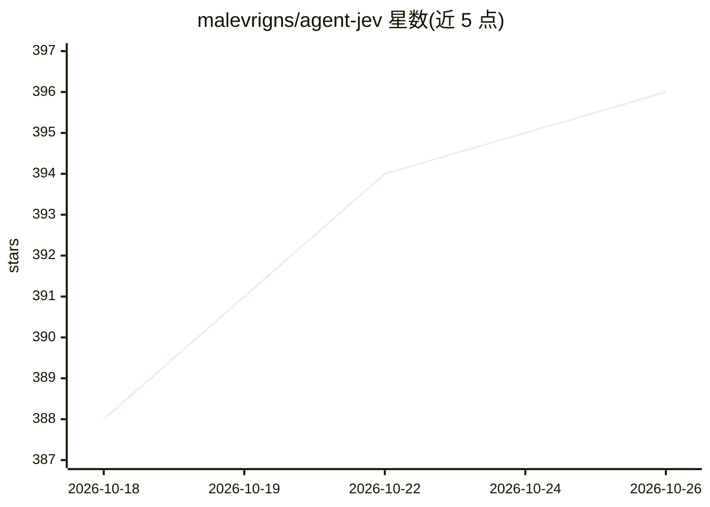

# malevrigns/agent-jev

⭐ 396 · Python · Apache-2.0 · 推送 2026-10-23 · [GitHub](https://github.com/malevrigns/agent-jev) · 个人维护 · 中文 README

**面向 Agent 决策门的 0.6B 分布输出模型，一次前向返回概率**

AgentJev-0.6B 是基于 Qwen3-0.6B（移除语言模型头）的专用决策模型：输入非结构化状态（diff、堆栈、工单、表格）与已拟定的类型化问题（Boolean/Choice/Score 三种原语），单次前向传播返回完整概率分布，不解码任何输出 token。服务端通过 token trie 共享前缀编码，将同状态多问题合并为一次前向（RTX 5060 上 P50 从 278ms 降至 43.89ms）。以 Python 服务形式运行，权重托管在 Hugging Face。限制：上下文 2,048 token，超长输入直接报错；基准为与教师分布的一致率，非真实 Agent 成功率；coding gates v1 在 348 个失败案例中将 123 个判为通过。

## 筛选速览

| 维度 | 判定 | 备注 |
|---|---|---|
| AI 角色 | `ai-native` | 本体是模型或模型工具 |
| 许可风险 | `permissive` | Apache-2.0 |
| 部署形态 | `None` |  |
| 模型依赖 | — | README 未给出锁定关系 |
| 硬件要求 | — | 无带数字的原话,不猜 |
| 安装摩擦 | `medium` | 含编译或系统依赖之一 |
| 成熟度 | — | 结构信号不足 |

## 能力要点

- 三种类型化决策原语（Boolean/Choice/Score），返回完整分布而非仅胜者
- 零输出 token 解码，隐状态直通 logits，无 JSON 修复问题
- token trie 共享前缀编码，同状态多问题单次前向（P50 43.89ms@RTX 5060）
- coding_gates 数据集：2,100 次真实测试运行记录，用于测试通过判定门

## 适用场景

- 在 Agent 循环中做门控/路由/打分，替代用大模型生成再解析布尔值
- 对测试是否通过、命令是否安全等决策获取可设阈值的概率输出
- 低延迟本地部署的决策组件（常驻显存约 1.4GB）

## 场景标签

`Agent 框架` · 领域:Agent 开发

## 证据(README 行号)

> L29: AgentJev-0.6B does not write. You hand it a state and questions you have already phrased. One forward pass returns 
> L98: |**AgentJev-0.6B, this run**|Specialist|**79.25%** · 1585/2000|**0.8494**|**0.0448**|0.1687|**0.2096**|

## 星数曲线

2026-10-18 388 → 2026-10-26 396（+8）

---
*卡片 v1 · prompt 1.4 · 生成 2026-10-21 · 置信度 high · 依据 README sha `025ee3d85ef0` · [字段定义](../../DATASET.md)*
