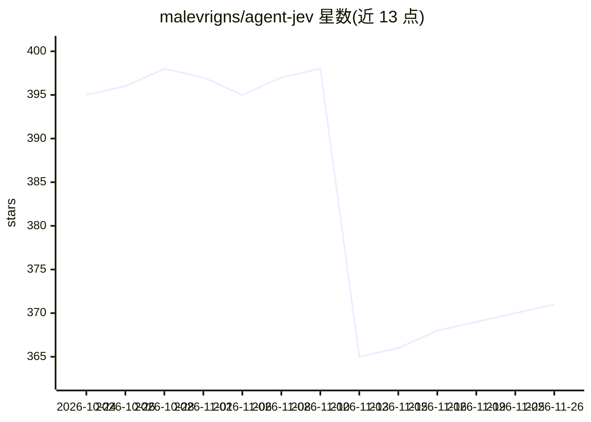

# malevrigns/agent-jev

⭐ 371 · Python · Apache-2.0 · 推送 2026-10-30 · [GitHub](https://github.com/malevrigns/agent-jev) · 个人维护 · 中文 README

**给 Agent 循环用的毫秒级决策小模型：状态进、分布出**

基于 Qwen3-0.6B（移除语言模型头）的 0.6B 决策模型，输入任意非结构化状态（diff、堆栈跟踪、工单、表格）与结构化问题，一次前向传播返回每个选项的概率分布，解码 token 数为零。提供 Boolean/Choice/Score 三种原语，均返回完整分布；支持 2,048 token 上下文，超长输入直接报错。通过 HTTP API 或 Python 客户端接入，状态编码一次供全部问题共享（token trie），在 RTX 5060 上单用例中位延迟 43.89 ms。权重托管在 Hugging Face，Apache-2.0 许可。README 明确说明其指标是与公开教师 argmax 的一致性，不是实测编码 agent 成功率。

## 筛选速览

| 维度 | 判定 | 备注 |
|---|---|---|
| AI 角色 | `ai-native` | 本体是模型或模型工具 |
| 许可风险 | `permissive` | Apache-2.0 |
| 部署形态 | `None` |  |
| 模型依赖 | — | README 未给出锁定关系 |
| 硬件要求 | — | 无带数字的原话,不猜 |
| 安装摩擦 | `medium` | 含编译或系统依赖之一 |
| 成熟度 | — | 结构信号不足 |

## 能力要点

- 三种类型化原语（Boolean/Choice/Score）均返回完整概率分布，零输出 token 解码
- 状态一次编码服务全部问题：token trie 共享前缀，骨干 token 从 4,074 降至 443
- 2,048 token 上下文，超长输入显式报错而非静默截断
- 另提供 coding_gates 测试结果判定数据集（pytest/unittest/jest/mocha/vitest/node --test）

## 适用场景

- Agent 循环中做门控、路由或打分（工具选择、命令安全性判定）
- 判定测试是否通过等非生成型 boolean 问题
- 工单分流、发票处理、客服流程中的类型化决策

## 场景标签

`推理引擎` · 领域:训练与推理

## 证据(README 行号)

> L28: AgentJev-0.6B does not write. You hand it a state and questions you have already phrased. One forward pass returns 
> L67: The backbone is Qwen3-0.6B with the language-model head removed. Each candidate is read at its last token. A small 
> L30: Use it as a framework-independent decision service wherever an agent loop needs a gate, a route, or a score. Integr

## 星数曲线

2026-10-24 395 → 2026-11-26 371（-24）

---
*卡片 v1 · prompt 1.4 · 生成 2026-11-25 · 置信度 high · 依据 README sha `391e093ae403` · [字段定义](../../DATASET.md)*
