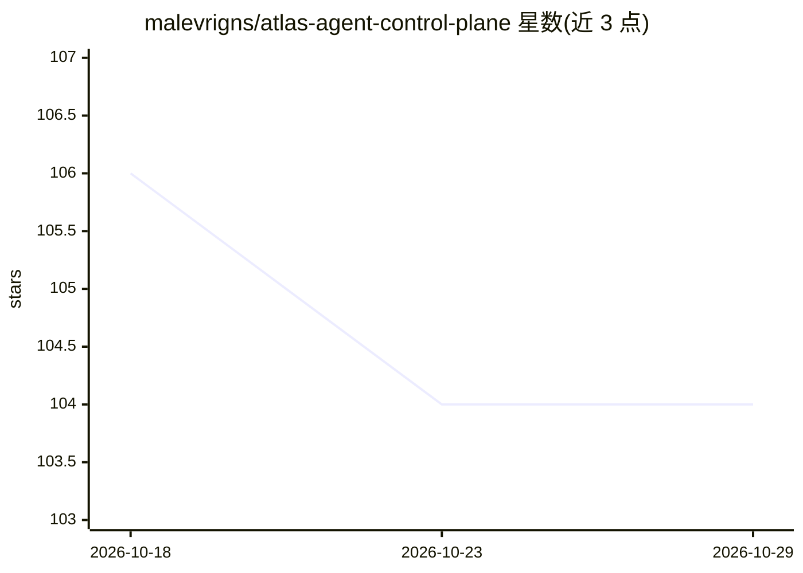

# malevrigns/atlas-agent-control-plane

⭐ 104 · Python · MIT · 推送 2026-09-13 · [GitHub](https://github.com/malevrigns/atlas-agent-control-plane) · [官网](https://github.com/malevrigns/atlas-agent-control-plane/blob/main/README.md) · 个人维护 · 中文 README

**可审计 AI agent 控制平面：证据记忆、工具门禁与检查点恢复**

面向垂类 agent 构建的控制平面系统：由 TypeScript Hono API、Next.js PWA 与 Textual TUI 组成。核心机制包括带来源写入门禁的记忆（衰减/巩固/冲突消解）、带引用置信度的多查询 RRF 融合 RAG、风险分级的工具运行时门禁、任务完成前的验收命令/范围审计/覆盖度评审三道关，以及基于状态哈希的 Checkpoint 恢复。快速启动仅需 Node 22+ 与 SQLite，完整形态需 Docker Compose；无 LLM 密钥时可离线运行（本地哈希 embedding），任何 OpenAI 兼容接口（DeepSeek/Qwen/DashScope/Ollama）经 llm.yaml 一行接入。另配 62 章从零重建教程。

## 筛选速览

| 维度 | 判定 | 备注 |
|---|---|---|
| AI 角色 | `ai-ecosystem` | LLM/agent 周边工具 |
| 许可风险 | `permissive` | MIT |
| 部署形态 | `self-host` | docker 或自建部署 |
| 模型依赖 | local-ok | 支持本地模型 |
| 硬件要求 | — | 无带数字的原话,不猜 |
| 安装摩擦 | `low` | 无编译、无系统依赖或容器化 |
| 成熟度 | — | 结构信号不足 |

## 能力要点

- 事实经写入门禁（来源/作用域/有效期）入库，附衰减与冲突消解
- 工具运行时门禁：风险分级→审批→幂等→超时→脱敏→制品化
- 任务完成需过验收命令 exit 0、范围审计、LLM 覆盖度评审三道关
- Checkpoint DAG 恢复：第 38 步挂掉可从第 17 步恢复；事件为唯一事实源

## 适用场景

- 构建需要逐条溯源的垂类 agent 工作流
- 长任务中断后从已验证的检查点恢复执行
- 对 agent 的工具调用与文件改动范围做审计

## 场景标签

`Agent 框架` `Agent 记忆` `RAG` · 领域:Agent 开发

## 证据(README 行号)

> L15: Along the way I kept running into the same wall: the demos were impressive, but the moment you ask *"where did this
> L27: |**A tool runtime with a gate**|Risk tier → approval → idempotency → timeout → redaction → artifact. The handler ru
> L45: That's SQLite plus the TypeScript Hono control plane. Open <http://localhost:8000/api/status>.

## 星数曲线

2026-10-18 106 → 2026-10-29 104（-2）

---
*卡片 v1 · prompt 1.4 · 生成 2026-10-23 · 置信度 high · 依据 README sha `231a72def8e7` · [字段定义](../../DATASET.md)*
