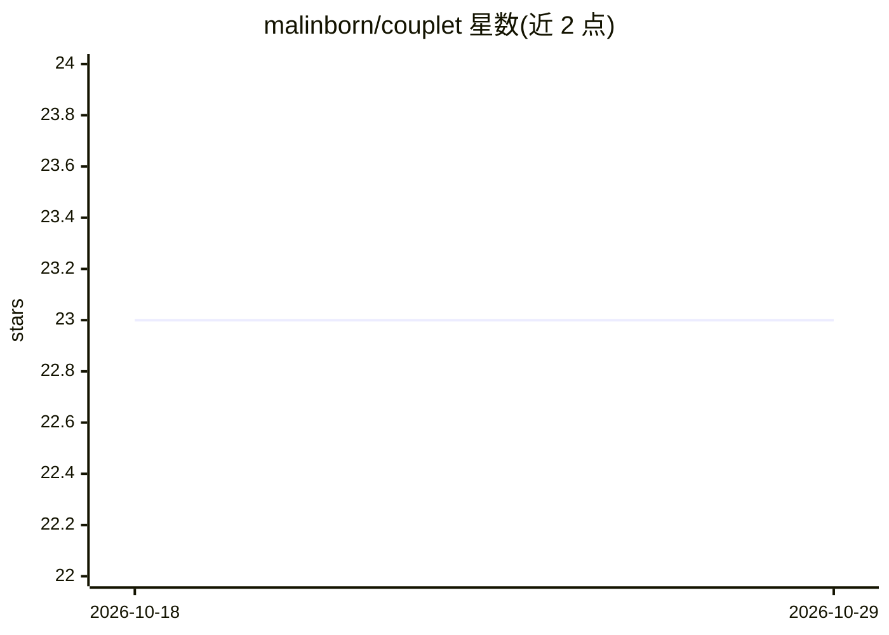

# malinborn/couplet

⭐ 23 · TypeScript · GPL-3.0 · 推送 2026-10-27 · [GitHub](https://github.com/malinborn/couplet) · [官网](https://malinborn.github.io/couplet/) · 个人维护

**macOS Markdown 编辑器：让 AI agent 与你共编同一文档**

基于 Tauri 2 / Svelte 5 / CodeMirror 6 的 macOS Markdown 编辑器，主打人机共编：agent 可经 stdio MCP 服务器（show/edit/ask 工具）或普通 shell 命令直接把整篇新文档推入实时缓冲区，编辑器自行 diff 并高亮变更，⌘Z 即撤销；用户可对任意片段写评论提问，agent 就地回复。本体不含 AI、不联网，智能来自外部 agent（如 Claude Code）。编辑功能含实时预览、GFM 表格、100+ 语言代码高亮、Mermaid 图、JSON 重排等。经 Homebrew cask 或 Releases 的通用 .dmg 安装；ad-hoc 签名导致升级后需重新授予文件夹访问权限。

## 筛选速览

| 维度 | 判定 | 备注 |
|---|---|---|
| AI 角色 | `ai-enhanced` | 去掉 AI 部分产品仍成立 |
| 许可风险 | `viral` | GPL-3.0 |
| 部署形态 | `desktop` | 安装包/桌面程序 |
| 模型依赖 | — | README 未给出锁定关系 |
| 硬件要求 | — | 无带数字的原话,不猜 |
| 安装摩擦 | `low` | 无编译、无系统依赖或容器化 |
| 成熟度 | `idea` | |

## 能力要点

- stdio MCP 服务器暴露 show/edit/ask 三工具，全部操作亦可作纯 shell 动词
- agent 编辑整篇推送后自动 diff、仅应用变更并高亮，滚动位置保留
- 片段评论线程存于 .mdmini_comments_*.md 纯 Markdown 边车文件，可 git diff、可在应用关闭时读写
- 实时预览、Mermaid 内联 SVG、100+ 语言代码高亮、文件监听自动重载

## 适用场景

- 让 Claude Code 等 agent 直接编辑我正打开的 Markdown 文档并看到高亮变更
- 在文档内对片段向 agent 提问、接收就地回复
- 把 agent 的回答折叠为文档中的正常 AI 编辑

## 场景标签

 · 领域:桌面编辑器/开发工具

## 证据(README 行号)

> L3: A markdown editor for macOS where you and your AI agent work in the same open document. The agent opens a file, scro
> L5: couplet contains no AI of its own and talks to no cloud. It exposes a local Unix socket and a stdio MCP server; the 

## 星数曲线

2026-10-18 23 → 2026-10-29 23（+0）

---
*卡片 v1 · prompt 1.4 · 生成 2026-10-27 · 置信度 mid · 依据 README sha `b08d8958e505` · [字段定义](../../DATASET.md)*
