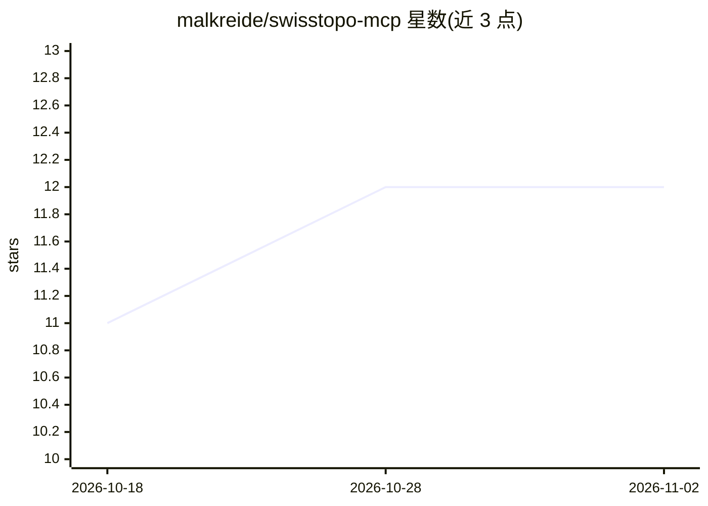

# malkreide/swisstopo-mcp

⭐ 12 · Python · MIT · 推送 2026-10-31 · [GitHub](https://github.com/malkreide/swisstopo-mcp) · 个人维护

**瑞士联邦地理数据的 MCP 服务器：让 AI 助手查询官方地理信息**

面向 Claude 等 MCP 主机的服务器，将 Swisstopo 等 API 封装为 20 个只读工具，覆盖瑞士地址地理编码与反编码、海拔与剖面、STAC 数据集检索、WMTS 地图 URL 生成、地块 EGRID/OEREB 查询、OpenStreetMap POI 与 OpenPLZ 行政层级解析（邮编→市镇/BFS 编号→区→州）。所有工具无需 API key（OEREB 需州支持）。支持 stdio 与 Streamable HTTP 双传输，可部署至 Render.com 供 claude.ai 浏览器使用；仅提供只读工具，写入工具未实现。

## 筛选速览

| 维度 | 判定 | 备注 |
|---|---|---|
| AI 角色 | `ai-ecosystem` | LLM/agent 周边工具 |
| 许可风险 | `permissive` | MIT |
| 部署形态 | `self-host` | docker 或自建部署 |
| 模型依赖 | — | README 未给出锁定关系 |
| 硬件要求 | — | 无带数字的原话,不猜 |
| 安装摩擦 | `low` | 无编译、无系统依赖或容器化 |
| 成熟度 | — | 结构信号不足 |

## 能力要点

- 20 个只读工具覆盖 Swisstopo REST、地理编码、海拔、STAC、WMTS、OEREB、geodienste.ch、OSM/Overpass 与 OpenPLZ
- 所有工具无需 API key（OEREB 提取需州支持）
- stdio 与 Streamable HTTP 双传输，支持云端部署
- 响应内置 BFS 市镇编号作为与瑞士统计数据的连接键

## 适用场景

- 在 Claude 中查询瑞士地址坐标、海拔与建筑信息
- 检索并下载瑞士正射影像、高程模型等地理数据集
- 查询地块 EGRID 编号与公共法律限制（OEREB）
- 通过 BFS 编号将地理数据与瑞士市镇级统计数据关联

## 场景标签

 · 领域:地理信息/MCP 工具

## 证据(README 行号)

> L18: `swisstopo-mcp` gives AI assistants access to Switzerland's official geodata infrastructure through 20 tools, all w
> L51: - ☁️ **Dual transport** -- stdio (Claude Desktop) + Streamable HTTP (cloud)
> L231: │   Claude / AI   │────▶│  swisstopo-mcp               │────▶│  Swisstopo REST API      │

## 星数曲线

2026-10-18 11 → 2026-11-02 12（+1）

---
*卡片 v1 · prompt 1.4 · 生成 2026-11-01 · 置信度 mid · 依据 README sha `0f1ee0e69790` · [字段定义](../../DATASET.md)*
