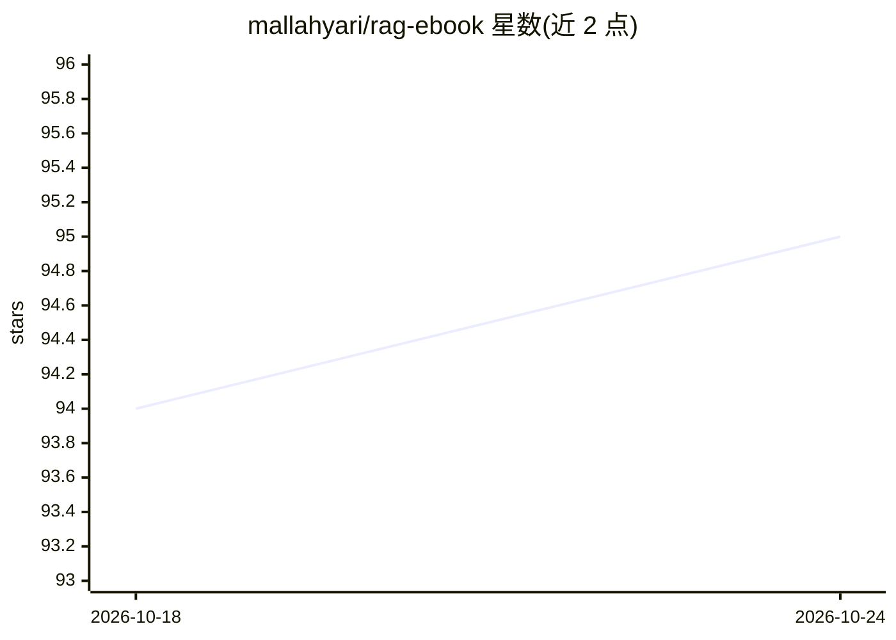

# mallahyari/rag-ebook

⭐ 95 · 推送 2026-06-03 · [GitHub](https://github.com/mallahyari/rag-ebook) · [官网](https://mallahyari.github.io/rag-ebook/) · 个人维护

**RAG 系统实践电子书的 HTML 源码仓库**

存放《A Practical Approach to Retrieval Augmented Generation (RAG) Systems》一书的 HTML 源码，使用 Quarto 构建。仓库内容为图书源文件而非可运行的软件，面向希望阅读或获取该书源码的读者与开发者。README 未提供额外安装或运行说明，仅说明仓库用途与构建工具。

## 筛选速览

| 维度 | 判定 | 备注 |
|---|---|---|
| AI 角色 | `ai-knowledge` | 知识聚合/清单类 |
| 许可风险 | `none` | — |
| 部署形态 | `None` |  |
| 模型依赖 | — | README 未给出锁定关系 |
| 硬件要求 | — | 无带数字的原话,不猜 |
| 安装摩擦 | `low` | 无编译、无系统依赖或容器化 |
| 成熟度 | — | 结构信号不足 |

## 能力要点

- 包含 RAG 系统实践一书的 HTML 源码
- 使用 Quarto 图书构建工具

## 适用场景

- 阅读 RAG 系统的实践方法电子书
- 获取该书源码用于本地构建或引用

## 场景标签

 · 领域:RAG/知识资源

## 证据(README 行号)

> L1: # A Practical Approach to Retrieval Augmented Generation (RAG) Systems
> L3: This repository contains the HTML source of A Practical Approach to Retrieval Augmented Generation (RAG) Systems boo

## 星数曲线

2026-10-18 94 → 2026-10-24 95（+1）

---
*卡片 v1 · prompt 1.4 · 生成 2026-10-23 · 置信度 mid · 依据 README sha `e2fc099d8769` · [字段定义](../../DATASET.md)*
