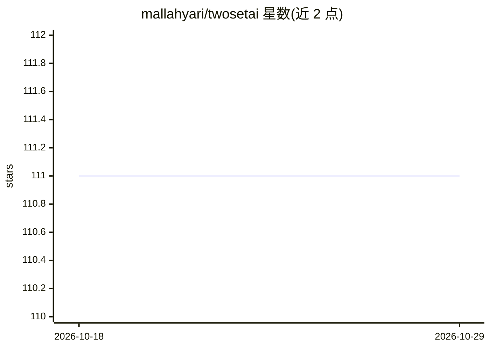

# mallahyari/twosetai

⭐ 111 · Jupyter Notebook · 推送 2026-02-15 · [GitHub](https://github.com/mallahyari/twosetai) · 组织维护

**TwoSetAI 频道的视频代码与教程材料仓库**

YouTube 频道 TwoSetAI 的配套代码与教程材料集合，覆盖其视频内容。频道内容定位为 AI 科普与教育，包括 AI 产品、最新趋势、工程洞察、AI 从业者职业建议与创业话题。团队介绍称曾获 Anthropic AI Developer Contest 2024，并关联咨询公司 OncillaAI 与 Newsletter（ML Notes）。README 未列出具体代码目录、安装或运行说明。

## 筛选速览

| 维度 | 判定 | 备注 |
|---|---|---|
| AI 角色 | `ai-knowledge` | 知识聚合/清单类 |
| 许可风险 | `none` | — |
| 部署形态 | `None` |  |
| 模型依赖 | — | README 未给出锁定关系 |
| 硬件要求 | — | 无带数字的原话,不猜 |
| 安装摩擦 | `low` | 无编译、无系统依赖或容器化 |
| 成熟度 | — | 结构信号不足 |

## 能力要点

- 频道视频的代码与教程材料集合
- 内容覆盖 AI 产品、趋势、工程与职业建议
- 团队关联咨询公司 OncillaAI 与 Newsletter ML Notes

## 适用场景

- 跟随视频学习并获取配套代码
- 浏览 AI 产品与工程相关教程材料

## 场景标签

`教程课程` · 领域:学习与行业

## 证据(README 行号)

> L1: # TwoSetAi YouTube Channel Materials
> L3: This repo includes all the code materials and tutorials for the videos of our channel TwoSetAi

## 星数曲线

2026-10-18 111 → 2026-10-29 111（+0）

---
*卡片 v1 · prompt 1.4 · 生成 2026-10-23 · 置信度 mid · 依据 README sha `292a3c92201a` · [字段定义](../../DATASET.md)*
