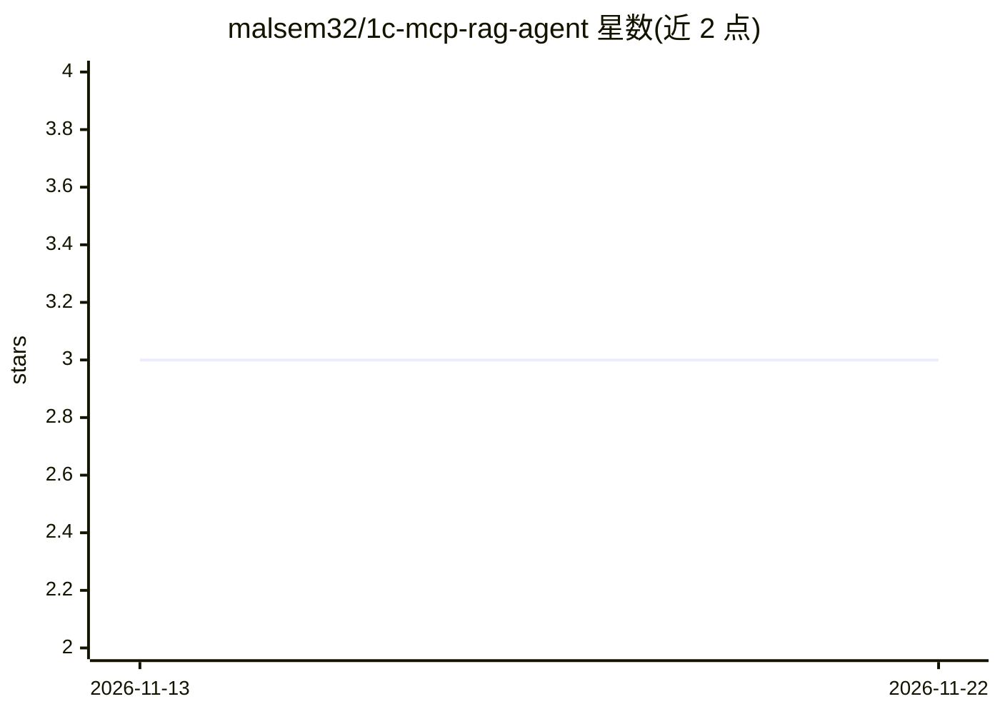

# malsem32/1c-mcp-rag-agent

⭐ 3 · Python · MIT · 推送 2026-11-11 · [GitHub](https://github.com/malsem32/1c-mcp-rag-agent) · 个人维护 · 中文 README

**让 AI 客户端检索和解释你的 1C:Enterprise 配置的 MCP 服务器**

面向 1C:Enterprise 8.3 开发者的 MCP 服务器与 RAG 工具：将用户导出的配置代码与元数据建立本地索引（Qdrant + fastembed），向 Claude Desktop、Cursor、LM Studio、Open WebUI 等 MCP 客户端提供 24 个工具，支持按问题检索代码、解释过账与字段填充逻辑、追踪调用链、分析权限与锁，并可组装 .epf 外部处理文件；可选接入 1C HTTP 服务后还可查询数据库数据并导出 Excel。仅只读不改库，索引与搜索模型本地运行。Windows 提供 4 步安装向导面板。

## 筛选速览

| 维度 | 判定 | 备注 |
|---|---|---|
| AI 角色 | `ai-ecosystem` | LLM/agent 周边工具 |
| 许可风险 | `permissive` | MIT |
| 部署形态 | `desktop` | 安装包/桌面程序 |
| 模型依赖 | — | README 未给出锁定关系 |
| 硬件要求 | — | 无带数字的原话,不猜 |
| 安装摩擦 | `low` | 无编译、无系统依赖或容器化 |
| 成熟度 | — | 结构信号不足 |

## 能力要点

- 24 个 MCP 工具覆盖代码检索、调用链追踪、元数据与权限分析
- 本地索引与搜索模型（Qdrant + fastembed），配置代码不出本机
- 可解析 .epf/.erf/.cfe 并生成外部处理文件
- 可选 HTTP/COM 模式连接 1C 数据库做报表与日志查询

## 适用场景

- 让 AI 解释我这套 1C 配置里某单据的过账逻辑
- 排查字段为什么没填值或单据为什么不过账
- 按问题检索配置代码、过程调用与权限设置
- 让 AI 直接查询 1C 数据库出报表并导出 Excel

## 场景标签

`RAG` `语义搜索` · 领域:知识与检索

## 证据(README 行号)

> L3: **MCP-сервер для 1С**: подключает Claude Desktop, Cursor, LM Studio или Open WebUI к **вашей** конфигурации 1С. ИИ и
> L5: *MCP server + RAG for 1C:Enterprise (1С:Предприятие 8.3). Semantic and keyword search over your configuration code a
> L44: Клиент видит 24 инструмента. Модель выбирает их сама; кроме того, встроенный роутер по формулировке вопроса сразу н

## 星数曲线

2026-11-13 3 → 2026-11-22 3（+0）

---
*卡片 v1 · prompt 1.4 · 生成 2026-11-21 · 置信度 high · 依据 README sha `2eb9e76315f0` · [字段定义](../../DATASET.md)*
