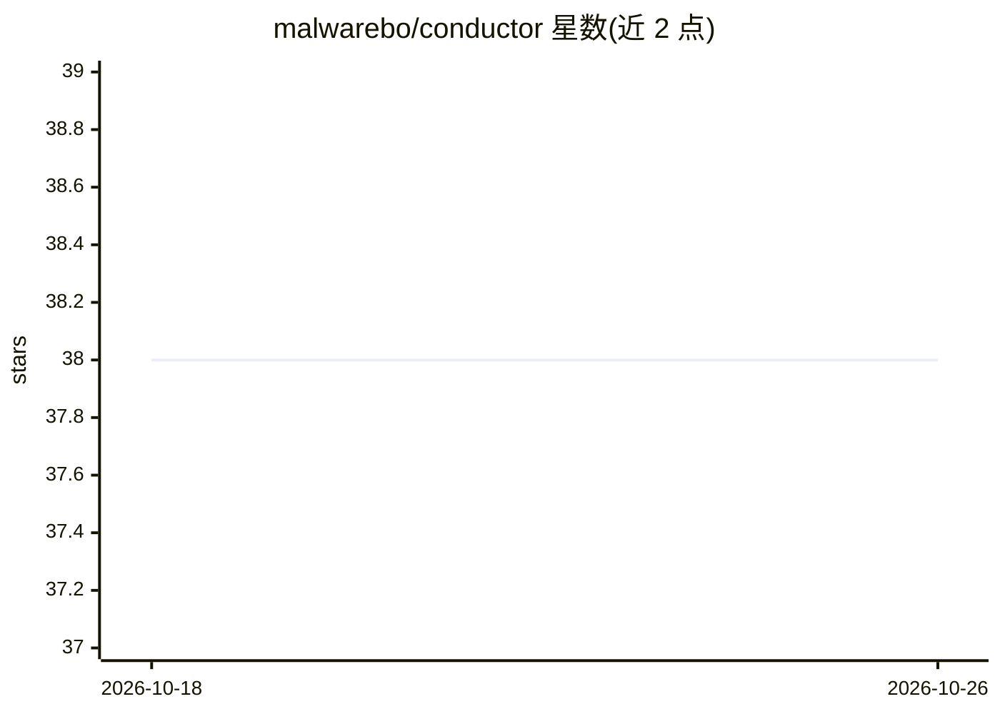

# malwarebo/conductor

⭐ 38 · Go · MIT · 推送 2026-09-19 · [GitHub](https://github.com/malwarebo/conductor) · 个人维护

**统一接入多家支付服务商的开源支付路由网关**

用 Go 编写的开源支付切换网关（payment switch），统一接入 Stripe、Xendit、Airwallex、Razorpay，提供支付、订阅与争议管理接口。路由层基于加权评分引擎（成功率、成本、延迟、健康度），支持熔断自动切换、BIN/IIN 卡路由、指数退避智能重试与按商户配置偏好。另含实验性 AI 欺诈检测，调用 OpenAI LLM 分析交易并对敏感数据匿名化。部署方式为源码编译或 docker-compose，依赖 PostgreSQL。

## 筛选速览

| 维度 | 判定 | 备注 |
|---|---|---|
| AI 角色 | `ai-enhanced` | 去掉 AI 部分产品仍成立 |
| 许可风险 | `permissive` | MIT |
| 部署形态 | `self-host` | docker 或自建部署 |
| 模型依赖 | — | README 未给出锁定关系 |
| 硬件要求 | — | 无带数字的原话,不猜 |
| 安装摩擦 | `low` | 无编译、无系统依赖或容器化 |
| 成熟度 | `idea` | |

## 能力要点

- 统一接口接入 Stripe/Xendit/Airwallex/Razorpay 四家支付服务商
- 加权评分路由引擎：熔断故障转移、BIN/IIN 路由、智能重试
- 实验性 AI 欺诈检测，交易处理前实时分析并对敏感数据匿名化
- API Key 认证（X-API-Key 或 Bearer），提供 Swagger/OpenAPI 文档

## 适用场景

- 业务需要多家支付服务商按地区/币种分流收款
- 支付服务商故障时自动切换与重试
- 在支付流程中接入实时欺诈交易拦截

## 场景标签

`网络安全` · 领域:学习与行业

## 证据(README 行号)

> L8: `Conductor` is an open-source payment switch that simplifies handling multiple payment providers. It supports Stripe
> L10: The system includes an `experimental` fraud detection with AI that analyzes transactions in real-time before proces

## 星数曲线

2026-10-18 38 → 2026-10-26 38（+0）

---
*卡片 v1 · prompt 1.4 · 生成 2026-10-25 · 置信度 high · 依据 README sha `6d176141dc7a` · [字段定义](../../DATASET.md)*
