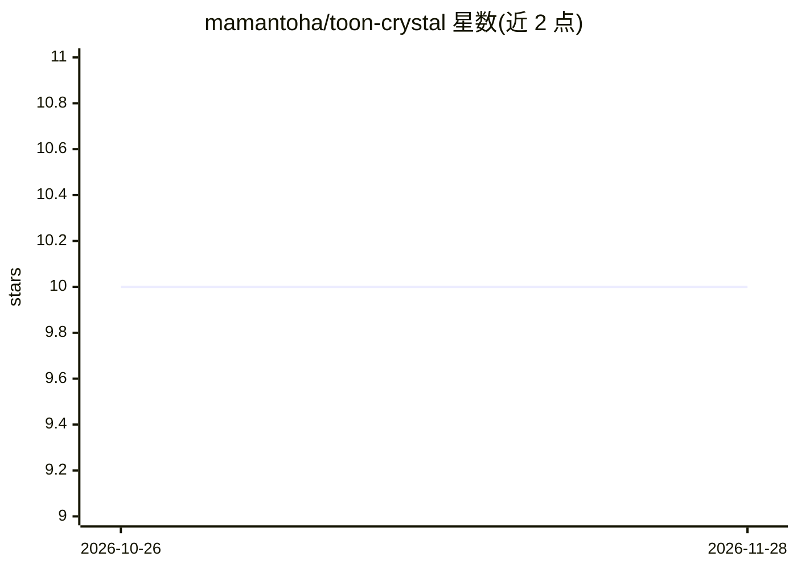

# mamantoha/toon-crystal

⭐ 10 · Crystal · MIT · 推送 2026-11-12 · [GitHub](https://github.com/mamantoha/toon-crystal) · 个人维护

**为开发者提供 TOON 格式的 Crystal 编解码库**

TOON（Token-Oriented Object Notation）序列化格式在 Crystal 语言的参考实现。该格式设计用于以更低 token 占用向大语言模型传递结构化数据，README 明确其面向 LLM 输入而非输出。实现遵循 TOON v4.4.0 规范并通过官方 fixture 测试套件，提供 Toon.encode/Toon.decode 双向 API，支持自定义缩进、分隔符与严格模式校验。以 Crystal shard 形式分发，测试用例通过 git submodule 引用上游规范仓库。

## 筛选速览

| 维度 | 判定 | 备注 |
|---|---|---|
| AI 角色 | `ai-ecosystem` | LLM/agent 周边工具 |
| 许可风险 | `permissive` | MIT |
| 部署形态 | `None` |  |
| 模型依赖 | — | README 未给出锁定关系 |
| 硬件要求 | — | 无带数字的原话,不猜 |
| 安装摩擦 | `low` | 无编译、无系统依赖或容器化 |
| 成熟度 | — | 结构信号不足 |

## 能力要点

- 实现 TOON v4.4.0 规范并通过官方 fixture 套件
- 提供 encode/decode 双向 API（encode L60、decode L83）
- 支持缩进、分隔符（','/'\t'/'|'）与 strict 校验参数
- 以 shard（shard.yml 依赖）形式安装

## 适用场景

- 在 Crystal 应用中把结构化数据编码为低 token 的格式喂给 LLM
- 解析 TOON 格式字符串还原为 Crystal 数据结构

## 场景标签

 · 领域:数据格式/LLM 基础设施

## 证据(README 行号)

> L7: **Token-Oriented Object Notation** is a compact, human-readable serialization format designed for passing structured
> L9: This is a Crystal reference implementation of the TOON format specification.

## 星数曲线

2026-10-26 10 → 2026-11-28 10（+0）

---
*卡片 v1 · prompt 1.4 · 生成 2026-11-19 · 置信度 high · 依据 README sha `6ce3b37ea3fe` · [字段定义](../../DATASET.md)*
