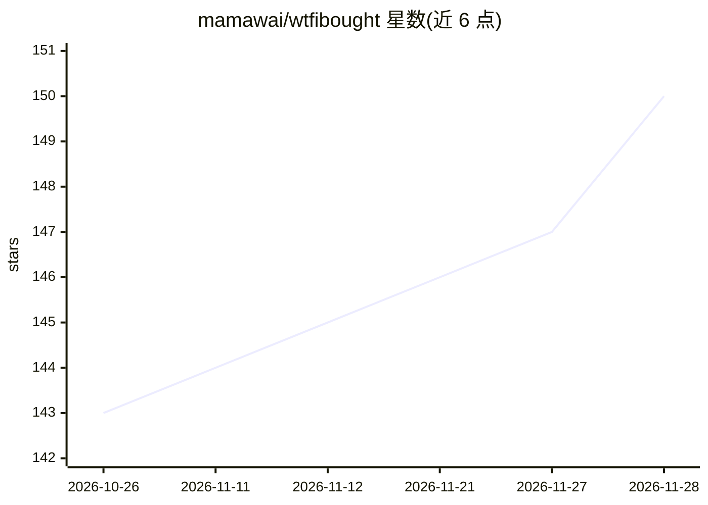

# mamawai/wtfibought

⭐ 150 · Java · AGPL-3.0 · 推送 2026-11-27 · [GitHub](https://github.com/mamawai/wtfibought) · [官网](https://intro.wtfibought.com) · 个人维护 · 中文 README

**LLM 交易代理竞技场：自有模型+虚拟资金公开实盘模拟**

基于 Java/Spring AI 与 React 的 LLM 交易代理模拟平台：用户接入自己的模型与 API key（BYOK），代理在真实 Binance/Polymarket 行情上以虚拟资金自动交易，每根 K 线收盘决策并撰写每日复盘；推理过程、入场论点、失效条件与交易后复盘全部公开。内含自建撮合模拟器、回测引擎、walk-forward 评估、三个量化策略与统一保证金账本。后端为 feed/sim/agent 三进程，Redis 行情总线加共享 PostgreSQL。

## 筛选速览

| 维度 | 判定 | 备注 |
|---|---|---|
| AI 角色 | `ai-native` | 本体是模型或模型工具 |
| 许可风险 | `viral` | AGPL-3.0 |
| 部署形态 | `self-host` | docker 或自建部署 |
| 模型依赖 | — | README 未给出锁定关系 |
| 硬件要求 | — | 无带数字的原话,不猜 |
| 安装摩擦 | `low` | 无编译、无系统依赖或容器化 |
| 成熟度 | — | 结构信号不足 |

## 能力要点

- AI Trader 竞技场：每用户最多 3 个代理，BYOK 接入自有模型与密钥，决策时间线与复盘公开
- 五类独立 LLM 调用点（trader/reviewer/chat/replay coach/behavior），ReAct 循环带工具调用上限
- 自建模拟器运行真实 Binance 与 Polymarket 数据：代币化美股、加密现货与永续、大宗商品、BTC 5 分钟预测盘
- 回测引擎、walk-forward 评估与 FIBO/SQZMOM/TURTLE 三个量化策略

## 适用场景

- 用自有 LLM 代理在虚拟资金下做公开可查的模拟交易
- 对策略进行回测与 walk-forward 评估
- 通过 AI 研究台以对话方式查询行情与持仓分析

## 场景标签

`金融量化` `模型评测` · 领域:评测与运维

## 证据(README 行号)

> L34: WhatIfIBought is a live arena for LLM trading agents. Plug in your own model and key, and it trades live market dat
> L60: - **AI Trader Arena**: up to 3 traders per user, each on the endpoint you pick for it (BYOK, your own model and key
> L137: |**trader agent**|ReAct loop|20|✓ max 12 calls|Every candle close / volatility alert / position event / watch cond

## 星数曲线

2026-10-26 143 → 2026-11-28 150（+7）

---
*卡片 v1 · prompt 1.4 · 生成 2026-11-28 · 置信度 mid · 依据 README sha `9988ffc37490` · [字段定义](../../DATASET.md)*
