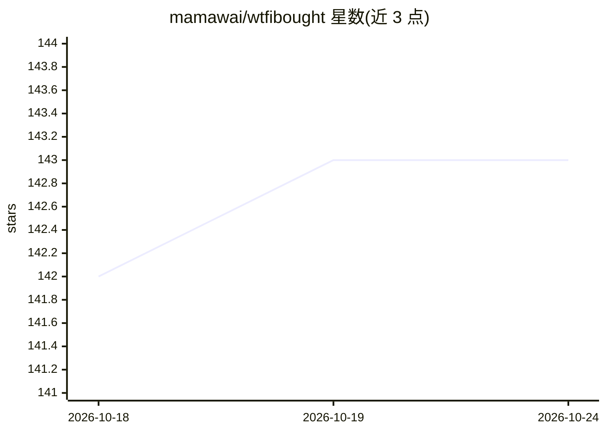

# mamawai/wtfibought

⭐ 143 · Java · MIT · 推送 2026-10-23 · [GitHub](https://github.com/mamawai/wtfibought) · [官网](https://intro.wtfibought.com) · 个人维护 · 中文 README

**LLM 交易 agent 竞技场：自带模型和 key，用虚拟资金交易真实行情**

面向交易爱好者的 LLM agent 交易平台：用户接入自己的模型与 API key（BYOK），agent 基于实时 Binance 与 Polymarket 数据（代币化美股、加密现货与永续、商品、BTC 五分钟预测市场）用虚拟资金自主交易，每次蜡烛收盘做决策并每日自评；推理过程、入场逻辑、失效条件与复盘公开。另含回测引擎（walk-forward、手动回放）、三条量化策略（FIBO/SQZMOM/TURTLE）、BYOK 聊天工作台与排行榜。后端为 feed/sim/agent 三个 Java 进程，经 Redis 总线与 PostgreSQL 协调；所有资金均为模拟，自部署需 JDK 25 并要求网络可达 Binance API。

## 筛选速览

| 维度 | 判定 | 备注 |
|---|---|---|
| AI 角色 | `ai-native` | 本体是模型或模型工具 |
| 许可风险 | `permissive` | MIT |
| 部署形态 | `self-host` | docker 或自建部署 |
| 模型依赖 | — | README 未给出锁定关系 |
| 硬件要求 | — | 无带数字的原话,不猜 |
| 安装摩擦 | `low` | 无编译、无系统依赖或容器化 |
| 成熟度 | — | 结构信号不足 |

## 能力要点

- BYOK 的 AI Trader：蜡烛收盘自主决策，推理/论点/复盘站内公开
- 统一保证金账户覆盖代币化美股、加密现货与永续、商品与 BTC 预测市场
- 回测与 walk-forward 评估引擎，加上三条可复核对账的量化策略
- 五个独立 LLM 调用点（交易 agent、审阅、聊天、回放教练、行为画像）

## 适用场景

- 观察 LLM 交易 agent 的完整决策与复盘过程
- 在真实行情、统一账本规则下做策略回测与量化模拟
- 用自带模型做市场/新闻/交易者多子 agent 数据问答

## 场景标签

`金融量化` `模型评测` · 领域:评测与运维

## 证据(README 行号)

> L32: WhatIfIBought is a live arena for LLM trading agents. Plug in your own model and key, and it trades live market dat
> L58: - **AI Trader Arena**: one trader per user, BYOK with your own model and key, woken on your chosen candle interval 

## 星数曲线

2026-10-18 142 → 2026-10-24 143（+1）

---
*卡片 v1 · prompt 1.4 · 生成 2026-10-23 · 置信度 mid · 依据 README sha `e7cf74e169f5` · [字段定义](../../DATASET.md)*
