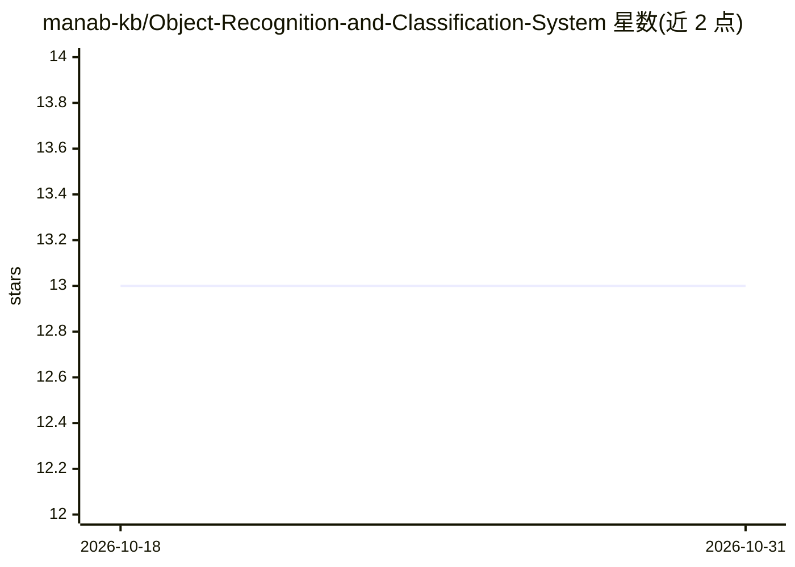

# manab-kb/Object-Recognition-and-Classification-System

⭐ 13 · Python · AGPL-3.0 · 推送 2026-10-23 · [GitHub](https://github.com/manab-kb/Object-Recognition-and-Classification-System) · [官网](https://github.com/Manab784/Object-Recognition-and-Classification-System) · 个人维护

**带 GUI 的图像识别与摄像头实时检测系统（CNN）**

通过 GUI 操作的图像目标识别与分类程序，分两部分：其一，用户从本地文件对话框上传 .png 图片，交由卷积神经网络（CNN）处理，GUI 显示类别名称与准确率百分比；其二，通过 Live Feed 按钮调用设备摄像头，将画面与预置参考图像比对判断是否有物体存在（摄像头画面窗口因安全原因显示为黑色）。仅支持 .png 输入，其他格式会报错。代码按 CNN.py、GUI.py、Image Detection.py 模块组织，模型为 .h5 文件。

## 筛选速览

| 维度 | 判定 | 备注 |
|---|---|---|
| AI 角色 | `ai-native` | 本体是模型或模型工具 |
| 许可风险 | `viral` | AGPL-3.0 |
| 部署形态 | `None` |  |
| 模型依赖 | — | README 未给出锁定关系 |
| 硬件要求 | — | 无带数字的原话,不猜 |
| 安装摩擦 | `low` | 无编译、无系统依赖或容器化 |
| 成熟度 | — | 结构信号不足 |

## 能力要点

- GUI 文件选择上传 .png 图片，CNN 返回类别名称与准确率
- 摄像头实时检测：与参考图像比对判断物体存在
- 代码模块化：CNN/GUI/实时检测分文件组织，模型为 .h5 文件

## 适用场景

- 上传本地图片查看其分类结果与置信度
- 用摄像头实时判断面前是否有目标物体

## 场景标签

`目标检测` · 领域:感知与多模态

## 证据(README 行号)

> L12: The user is given a choice to select local files from the file dialogue of their own device and upload it into the 

## 星数曲线

2026-10-18 13 → 2026-10-31 13（+0）

---
*卡片 v1 · prompt 1.4 · 生成 2026-10-31 · 置信度 mid · 依据 README sha `b4a1c0bd6ffc` · [字段定义](../../DATASET.md)*
