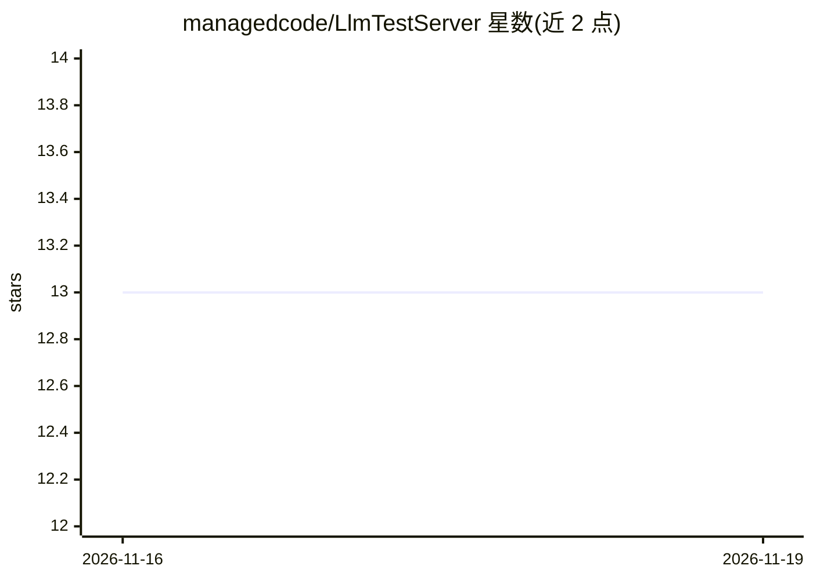

# managedcode/LlmTestServer

⭐ 13 · C# · MIT · 推送 2026-10-28 · [GitHub](https://github.com/managedcode/LlmTestServer) · [官网](https://llmtest.managed-code.com) · 组织维护

**给 .NET 及多语言应用的确定性 LLM API 模拟测试服务器**

本地运行的模拟服务器，以 OpenAI、Anthropic、Gemini 等十余家提供商的 API 形式响应请求，返回测试预脚本化的回复、流式输出、工具调用、限流与内容过滤，服务器本身不调用真实模型。应用保留官方 SDK，仅更改 base URL 指向对应命名空间。提供令牌用量分解、提示缓存命中统计的仪表盘，支持带条件分支的会话图 DSL、管理 API 与并行隔离测试会话。Docker 镜像供任意语言栈使用，.NET 侧提供 NuGet 包与 Aspire 集成。

## 筛选速览

| 维度 | 判定 | 备注 |
|---|---|---|
| AI 角色 | `ai-ecosystem` | LLM/agent 周边工具 |
| 许可风险 | `permissive` | MIT |
| 部署形态 | `self-host` | docker 或自建部署 |
| 模型依赖 | local-ok | 支持本地模型 |
| 硬件要求 | — | 无带数字的原话,不猜 |
| 安装摩擦 | `low` | 无编译、无系统依赖或容器化 |
| 成熟度 | — | 结构信号不足 |

## 能力要点

- 脚本化回复、流式输出、工具调用、429 限流与内容过滤等故障模拟
- 令牌用量按系统提示/工具模式/历史/工具结果分解并统计提示缓存读写
- 带条件、分支与循环的会话图 DSL，按消息匹配选择下一回复
- 请求检查器与流量图表仪表盘，请求日志可查询验证

## 适用场景

- 在 CI 中为调用 LLM API 的应用编写确定性集成测试
- 模拟限流与内容过滤验证应用的容错逻辑
- 检查应用发送的提示构成与令牌开销
- 为多轮对话应用测试分支路径（如退款/查询流程）

## 场景标签

 · 领域:LLM 基础设施/测试

## 证据(README 行号)

> L22: LLM Test Server is a local server that answers like an LLM provider — OpenAI, Anthropic, Gemini and ten more — but
> L268: The server never calls a real model, and nothing is hidden behind retries or randomness.

## 星数曲线

2026-11-16 13 → 2026-11-19 13（+0）

---
*卡片 v1 · prompt 1.4 · 生成 2026-11-18 · 置信度 mid · 依据 README sha `c24e15736f6a` · [字段定义](../../DATASET.md)*
