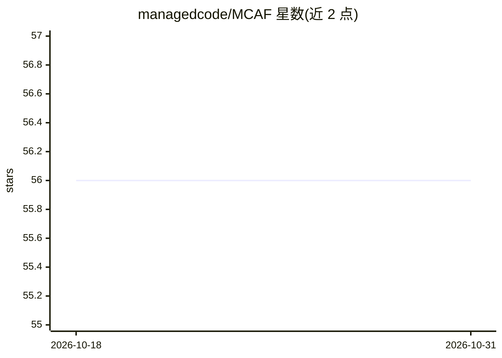

# managedcode/MCAF

⭐ 56 · CSS · CC-BY-4.0 · 推送 2026-10-11 · [GitHub](https://github.com/managedcode/MCAF) · [官网](https://mcaf.managed-code.com/) · 组织维护

**与 AI 编码代理协作构建软件工程的框架（上下文/验证/指令）**

Managed Code 维护的 AI 编码代理工程框架：定义将代码、文档、AGENTS.md 与技能等工程上下文保存在仓库中的规则，要求代理从架构文档与功能切片出发工作，以集成测试与质量门禁作为验收依据。核心机制包括仓库根与项目级 AGENTS.md、按业务能力组织的垂直切片结构、可执行的 REQ/AC/ADR 需求契约、禁止 mock 的分层验证与覆盖率门槛（80% 行/70% 分支）。v1.3 为 skill-first，提供最小化引导模板与技能目录，兼容 Codex 与 Claude Code 的技能目录位置。

## 筛选速览

| 维度 | 判定 | 备注 |
|---|---|---|
| AI 角色 | `ai-ecosystem` | LLM/agent 周边工具 |
| 许可风险 | `viral` | CC-BY-4.0 |
| 部署形态 | `None` |  |
| 模型依赖 | — | README 未给出锁定关系 |
| 硬件要求 | — | 无带数字的原话,不猜 |
| 安装摩擦 | `medium` | 含编译或系统依赖之一 |
| 成熟度 | — | 结构信号不足 |

## 能力要点

- 三要素：仓库内工程上下文、测试与质量门禁验证、AGENTS.md 版本化指令
- 按业务能力组织的垂直切片结构（backend/frontend/contracts/tests/docs 同名对齐）
- 可执行需求契约 REQ-*/AC-*/ADR 与追溯矩阵
- 禁止 mock 的分层验证及覆盖率门槛（≥80% 行/≥70% 分支）

## 适用场景

- 为 AI 编码代理制定可预测、可验证的工程协作规范
- 组织仓库结构使代理能按功能切片定位代码与文档
- 建立以集成测试和质量门禁为准的代理产出验收流程

## 场景标签

 · 领域:软件开发/AI 代理工程

## 证据(README 行号)

> L10: MCAF is a framework for building real software with AI coding agents.
> L26: - **Verification** — integration tests and quality gates are the decision makers, not opinions.

## 星数曲线

2026-10-18 56 → 2026-10-31 56（+0）

---
*卡片 v1 · prompt 1.4 · 生成 2026-10-24 · 置信度 high · 依据 README sha `87c451cbc920` · [字段定义](../../DATASET.md)*
