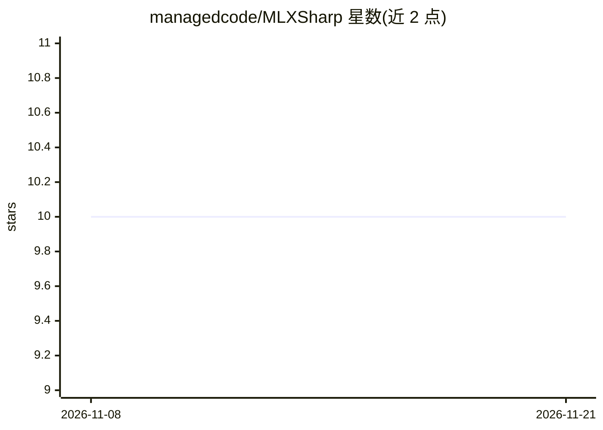

# managedcode/MLXSharp

⭐ 10 · C# · MIT · 推送 2026-11-16 · [GitHub](https://github.com/managedcode/MLXSharp) · 组织维护

**在 .NET 中接入 Apple MLX 的封装库**

围绕 Apple MLX 的 .NET 封装库，实现 IChatClient、IEmbeddingGenerator 接口并提供图像辅助功能，直接接入 Microsoft.Extensions.AI 生态；提供依赖注入扩展与 Semantic Kernel 集成包。设计目标为 macOS Apple silicon，同时通过 NuGet 提供 macOS 与 Linux 预编译原生二进制；本机原生推理管线仍处于实验阶段，测试流程目前依赖 Python 的 mlx_lm。Windows 尚不支持。

## 筛选速览

| 维度 | 判定 | 备注 |
|---|---|---|
| AI 角色 | `ai-ecosystem` | LLM/agent 周边工具 |
| 许可风险 | `permissive` | MIT |
| 部署形态 | `library` | 以包/库形式分发 |
| 模型依赖 | — | README 未给出锁定关系 |
| 硬件要求 | — | 无带数字的原话,不猜 |
| 安装摩擦 | `high` | 编译与系统依赖俱全 |
| 成熟度 | — | 结构信号不足 |

## 能力要点

- 实现 IChatClient 与 IEmbeddingGenerator 接口，接入 Microsoft.Extensions.AI
- 提供 AddMlx 依赖注入扩展与 Semantic Kernel 集成包
- NuGet 附带 macOS/Linux 预编译原生库，开箱可用
- 原生模型推理管线为实验性，未完成前默认走 Python mlx_lm 路径

## 适用场景

- 在 .NET 应用中通过 IChatClient 接口调用 Apple silicon 上的 MLX 模型
- 与 Semantic Kernel 集成在 macOS 上做聊天补全与嵌入生成
- 为 MLX 模型构建 .NET 侧的集成测试与验证流程

## 场景标签

`推理引擎` · 领域:训练与推理

## 证据(README 行号)

> L6: MLXSharp is the first .NET wrapper around Apple MLX that plugs straight into `Microsoft.Extensions.AI`. It is design
> L9: - .NET 9 / C# 13 preview friendly APIs that implement `IChatClient`, `IEmbeddingGenerator<string, Embedding<float>>`
> L125: This initial release is focused on macOS developers who want MLX inside .NET applications. Linux binaries are prod

## 星数曲线

2026-11-08 10 → 2026-11-21 10（+0）

---
*卡片 v1 · prompt 1.4 · 生成 2026-11-19 · 置信度 mid · 依据 README sha `dc5c27d7f391` · [字段定义](../../DATASET.md)*
