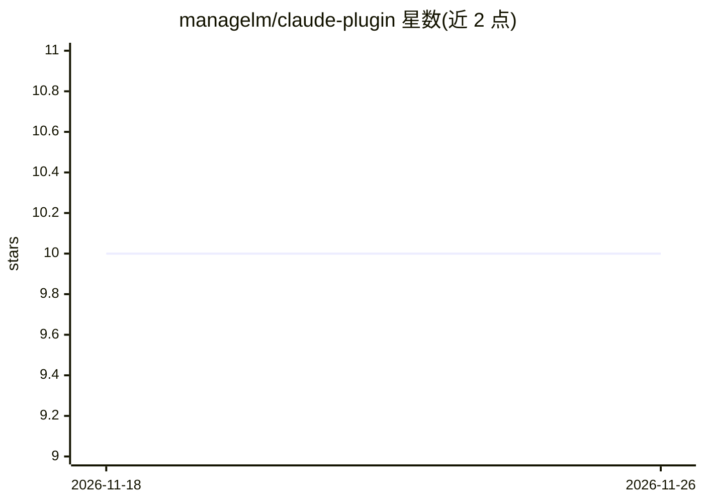

# managelm/claude-plugin

⭐ 10 · Apache-2.0 · 推送 2026-11-17 · [GitHub](https://github.com/managelm/claude-plugin) · [官网](https://www.managelm.com/plugins/claude.html) · 组织维护

**让 Claude 通过自然语言管理 Linux/Windows 服务器的插件**

ManageLM 发布的 Claude 插件：通过 MCP、云端控制台与装在服务器上的轻量 agent，把 Claude（claude.ai、Cowork、Claude Code）接入基础设施，用自然语言完成系统状态检查、软件包管理、服务配置、文件传输、安全审计等操作，覆盖单机或整批服务器。插件本身不含代码，仅提供 skills 并连接 ManageLM MCP 服务端；认证用 OAuth 2.0 动态客户端注册，agent 任务用 Ed25519 签名，agent 出站连接、无需开放入站端口，账号免费额度为 10 台 agent。

## 筛选速览

| 维度 | 判定 | 备注 |
|---|---|---|
| AI 角色 | `ai-enhanced` | 去掉 AI 部分产品仍成立 |
| 许可风险 | `permissive` | Apache-2.0 |
| 部署形态 | `None` |  |
| 模型依赖 | locked-api |  |
| 硬件要求 | — | 无带数字的原话,不猜 |
| 安装摩擦 | `low` | 无编译、无系统依赖或容器化 |
| 成熟度 | — | 结构信号不足 |

## 能力要点

- 33 个内置 skills（软件包、服务、防火墙、数据库、容器/K8s、证书、VPN、Active Directory 等）
- 33 个管理/发现工具：跨基础设施搜索、任务历史与回滚、安全审计
- agent 仅出站连接，无需开放入站端口或 SSH
- 支持自托管 portal 与本地模型，数据不出基础设施

## 适用场景

- 用自然语言批量检查或配置多台服务器
- 对整个服务器编队运行安全审计并修复问题
- 通过 Claude 执行文件上传下载与任务回滚

## 场景标签

 · 领域:DevOps/基础设施管理

## 证据(README 行号)

> L16: Ask Claude to check system status, manage packages, configure services, transfer files, run security audits, and mo
> L170: The plugin contains no code: it adds skills and connects Claude to the ManageLM MCP server at `https://app.managel
> L174: - **claude.ai, Cowork or Claude Code 2.0.12+** for the plugin, or any MCP client with remote HTTP servers for the 

## 星数曲线

2026-11-18 10 → 2026-11-26 10（+0）

---
*卡片 v1 · prompt 1.4 · 生成 2026-11-19 · 置信度 high · 依据 README sha `26c989cf3932` · [字段定义](../../DATASET.md)*
