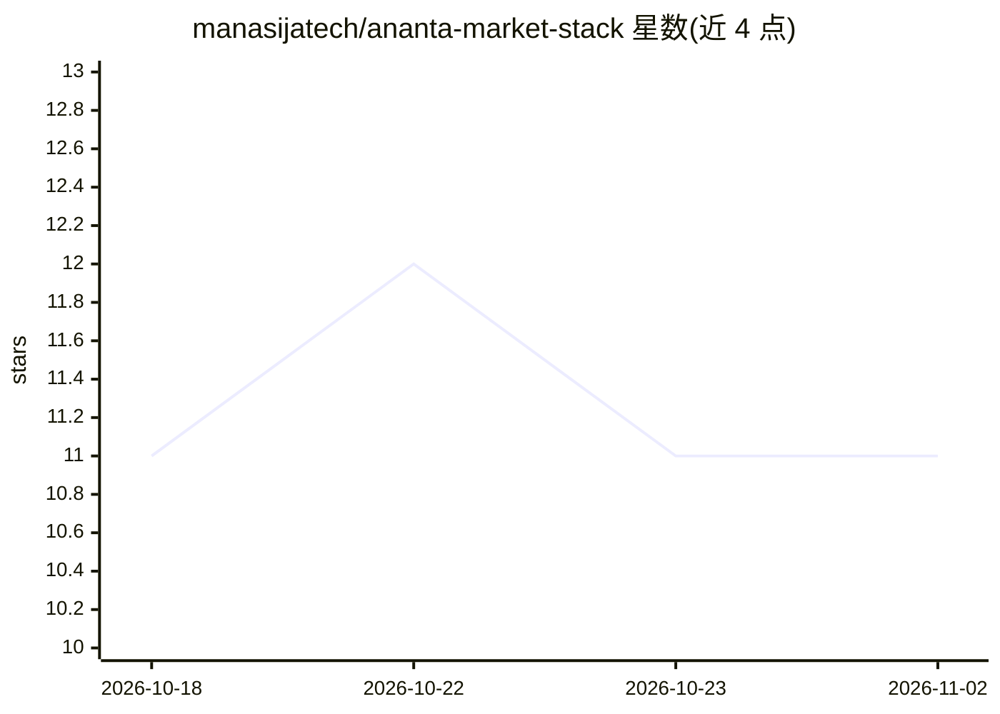

# manasijatech/ananta-market-stack

⭐ 11 · TypeScript · MIT · 推送 2026-11-01 · [GitHub](https://github.com/manasijatech/ananta-market-stack) · [官网](https://manasija.in/ananta-market-stack) · 组织维护

**自托管交易与行情工作台：统一接入多家印度券商账户**

FastAPI + Next.js 的自托管交易工作区：集中管理券商账户与登录会话，加密存储凭证，查看持仓/订单/资金等组合数据，获取行情并运行用户自建告警工作流。支持 7 家印度券商（Zerodha、Upstox、Angel、Dhan、Groww、INDmoney、Kotak），可搭配 Drishti 印度股市数据 API。发布单镜像 Docker 运行，内置 SQLite、Redis 与首启生成的密钥；也可源码 Compose 构建。描述中称其为交易研究助手，仓库带 artificial-intelligence 主题标签，但 README 未描述具体 AI 功能。

## 筛选速览

| 维度 | 判定 | 备注 |
|---|---|---|
| AI 角色 | `ai-enhanced` | 去掉 AI 部分产品仍成立 |
| 许可风险 | `permissive` | MIT |
| 部署形态 | `self-host` | docker 或自建部署 |
| 模型依赖 | — | README 未给出锁定关系 |
| 硬件要求 | — | 无带数字的原话,不猜 |
| 安装摩擦 | `low` | 无编译、无系统依赖或容器化 |
| 成熟度 | — | 结构信号不足 |

## 能力要点

- 统一券商操作：档案、订单、成交、持仓、资金、行情、智能下单、一键平仓、保证金计算
- 7 家印度券商接入与应用内配置指南
- Fernet 密钥加密的券商凭证存储
- 单 Docker 镜像运行，内置 SQLite、Redis 与首启生成密钥

## 适用场景

- 在一个界面管理多家印度券商账户与组合数据
- 本地或自托管部署运行行情告警工作流
- 作为 FastAPI + Next.js 的券商账户管理参考实现

## 场景标签

`金融量化` · 领域:学习与行业

## 证据(README 行号)

> L7: Ananta Market Stack is a self-hosted trading and market-data workspace for connecting broker accounts, managing brok
> L9: It is built for people who want a practical local or self-hosted market workspace without wiring together every brok

## 星数曲线

2026-10-18 11 → 2026-11-02 11（+0）

---
*卡片 v1 · prompt 1.4 · 生成 2026-11-02 · 置信度 mid · 依据 README sha `70f899525024` · [字段定义](../../DATASET.md)*
