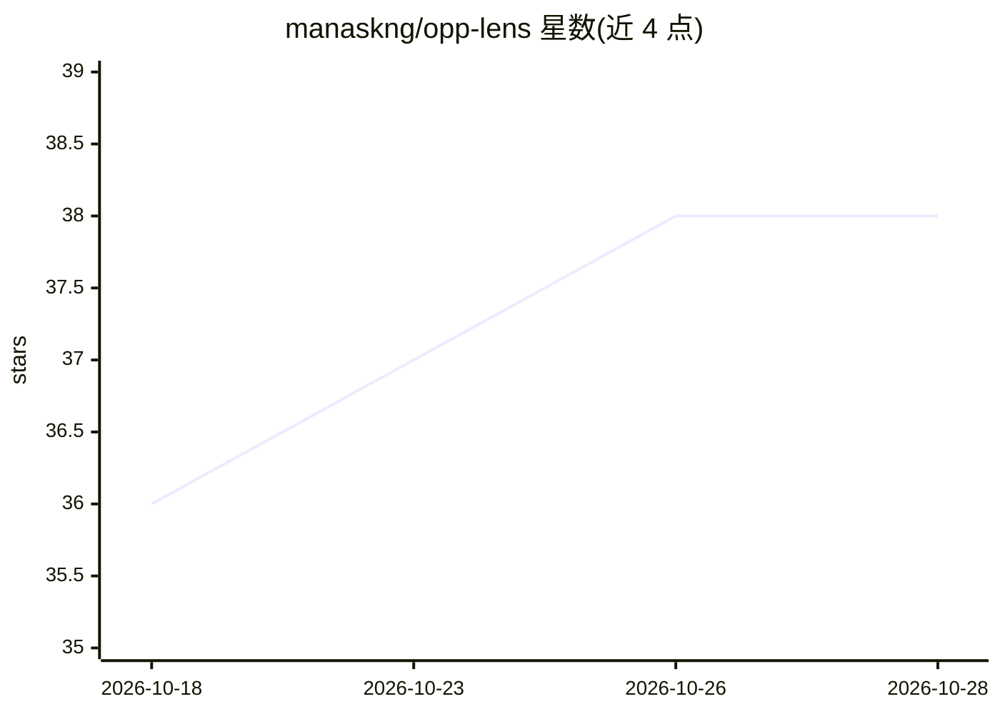

# manaskng/opp-lens

⭐ 38 · TypeScript · 推送 2026-10-19 · [GitHub](https://github.com/manaskng/opp-lens) · [官网](https://opp-lens.vercel.app/) · 个人维护

**面向开发者的技术活动平台，含爬取管线与推荐服务**

全栈 Web 平台，供开发者发现、创建和管理 meetup 与黑客松活动。主体功能包括 NextAuth v5 多方式登录（GitHub/Google/邮箱）、事件创建与原子化抢票预订、开发者个人主页、动态社交分享卡片等。AI 相关部分为 Python/FastAPI 微服务：基于 Playwright 的异步爬取管线（5 个平台、5000+ 条机会）、组合键哈希去重、TF-IDF + 余弦相似度的混合推荐，并将语义匹配卸载到 MongoDB Atlas Vector Search。本地运行需 Node.js v20+、MongoDB 实例，可选 Redis 缓存。

## 筛选速览

| 维度 | 判定 | 备注 |
|---|---|---|
| AI 角色 | `ai-enhanced` | 去掉 AI 部分产品仍成立 |
| 许可风险 | `none` | — |
| 部署形态 | `library` | 以包/库形式分发 |
| 模型依赖 | — | README 未给出锁定关系 |
| 硬件要求 | — | 无带数字的原话,不猜 |
| 安装摩擦 | `low` | 无编译、无系统依赖或容器化 |
| 成熟度 | — | 结构信号不足 |

## 能力要点

- FastAPI + Playwright 爬取管线，摄入 5,000+ 条来自 5 个平台的活动数据
- 组合键哈希去重引擎，消除约 95% 冗余数据库写入
- 混合推荐引擎（TF-IDF + 余弦相似度 + 协同过滤），结合 Atlas Vector Search 与 Redis 缓存
- 基于 MongoDB 原子操作的防超卖预订系统

## 适用场景

- 作为开发者查找和参加附近的线下技术活动与黑客松
- 组织者发布活动并管理座位库存与报名
- 通过个性化信息流获得按兴趣推荐的活动

## 场景标签

`网页抓取` `推荐系统` · 领域:效率与自动化

## 证据(README 行号)

> L7: **OppLens** is a modern, full-stack platform designed to connect developers through tech events. It goes beyond simp
> L49: - **Smart Recommendation Engine**: A hybrid NLP recommendation engine (TF-IDF + Cosine Similarity + Collaborative F
> L141: - `recommendation-service/`: Python microservice for web scraping and ML recommendations.

## 星数曲线

2026-10-18 36 → 2026-10-28 38（+2）

---
*卡片 v1 · prompt 1.4 · 生成 2026-10-25 · 置信度 mid · 依据 README sha `d95acfeaca60` · [字段定义](../../DATASET.md)*
