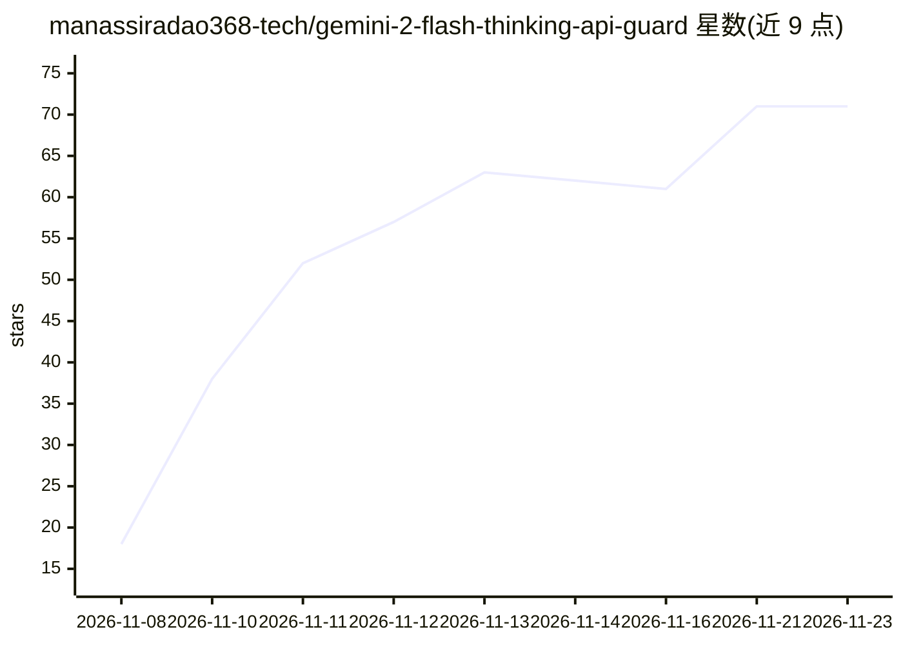

# manassiradao368-tech/gemini-2-flash-thinking-api-guard

⭐ 71 · 推送 2026-11-05 · [GitHub](https://github.com/manassiradao368-tech/gemini-2-flash-thinking-api-guard) · [官网](https://app.coregold.io/signup?invite_code=ADvlj9b) · 组织维护 · 中文 README

**面向开发者的 GCP 扣费避坑指南，推介 CoreGold 商用卡方案**

README 以 Gemini 2.0 Flash Thinking 并发调用场景为背景，描述 GCP 绑卡时国内双币卡报 OR_CCCHS_01 拒付、预算告警无硬熔断、AVS 地址校验失败等问题，并给出三步方案：在 CoreGold 控制台以 USDT 充值开立商业卡段（414742/428837）虚拟卡、设单卡限额、绑定后跑完销卡。全文未提供任何可安装运行的代码或脚本，尾部附推广链接与哈希串，性质接近支付产品推广文而非软件项目。

## 筛选速览

| 维度 | 判定 | 备注 |
|---|---|---|
| AI 角色 | `ai-knowledge` | 知识聚合/清单类 |
| 许可风险 | `none` | — |
| 部署形态 | `None` |  |
| 模型依赖 | — | README 未给出锁定关系 |
| 硬件要求 | — | 无带数字的原话,不猜 |
| 安装摩擦 | `low` | 无编译、无系统依赖或容器化 |
| 成熟度 | — | 结构信号不足 |

## 能力要点

- 解释 GCP 结算账户对卡片 IIN/BIN、AVS 的审核机制
- 给出 CoreGold 虚拟卡三步部署流程（充值/开卡/绑定销卡）
- 示例中对比亚太个人双币卡与 CoreGold 卡段的清算响应

## 适用场景

- 了解 GCP 绑卡被拒付的常见原因
- 为批量 API 任务设置单卡限额与账单熔断

## 场景标签

 · 领域:云服务计费/支付工具

## 证据(README 行号)

> L1: # gemini-2-flash-thinking-api-guard
> L2: Google Gemini 2.0 Flash Thinking 深度长思考 API 扣费避坑：解决 GCP 预授权频繁拒付、并发配额超支与账单熔断。
> L35: 👉 **立即进入 CoreGold 开卡控制台**

## 星数曲线

2026-11-08 18 → 2026-11-23 71（+53）

---
*卡片 v1 · prompt 1.4 · 生成 2026-11-18 · 置信度 low · 依据 README sha `d51733768635` · [字段定义](../../DATASET.md)*
