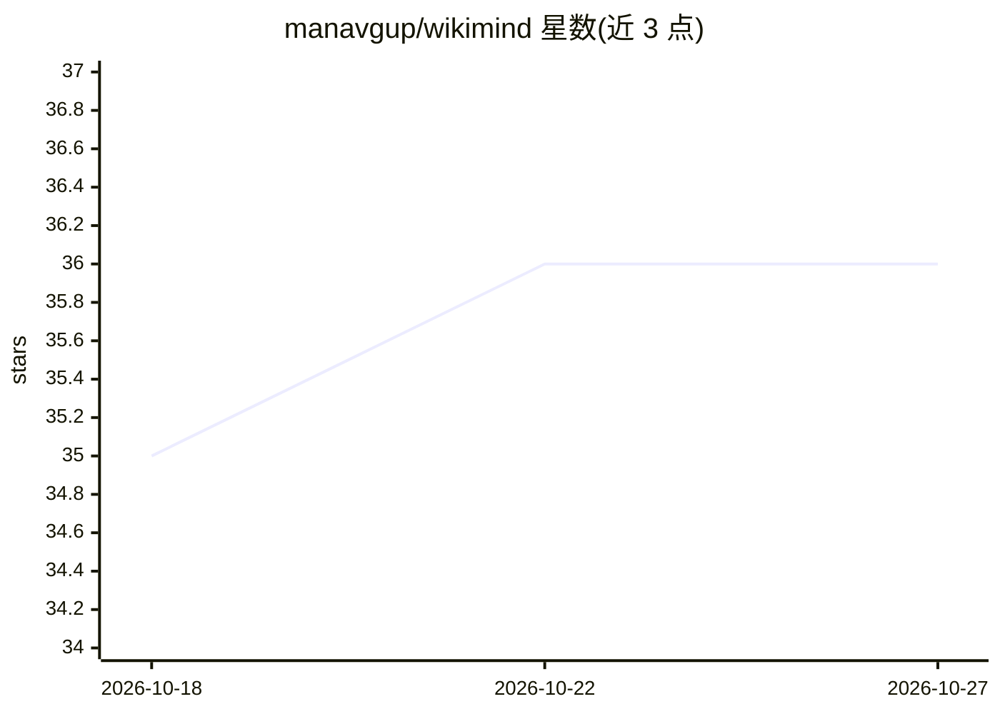

# manavgup/wikimind

⭐ 36 · Python · MIT · 推送 2026-07-19 · [GitHub](https://github.com/manavgup/wikimind) · [官网](https://manavgup.github.io/wikimind/) · 个人维护

**个人 LLM 知识系统：把多来源资料编译为带引用的结构化 wiki**

面向个人知识管理的自托管 Web 应用：接入 URL、PDF（含图表提取）、YouTube、RSS 等来源，由 LLM 编译成含关键论断、置信度与引用的 wiki 文章，自动抽取概念构建双向链接知识图谱；支持带引用的 RAG 问答、跨文章综合分析，并用 LLM 检查矛盾、孤立与过期内容。提供多用户认证、MCP 服务端（13 工具）供 Claude Desktop/Cursor 接入、浏览器扩展与 Electron 桌面壳。后端 FastAPI + PostgreSQL，支持 Docker Compose 与 Fly.io 部署；LLM 后端可切换 Claude/GPT/Gemini/Ollama 等。

## 筛选速览

| 维度 | 判定 | 备注 |
|---|---|---|
| AI 角色 | `ai-native` | 本体是模型或模型工具 |
| 许可风险 | `permissive` | MIT |
| 部署形态 | `self-host` | docker 或自建部署 |
| 模型依赖 | local-ok | 支持本地模型 |
| 硬件要求 | — | 无带数字的原话,不猜 |
| 安装摩擦 | `low` | 无编译、无系统依赖或容器化 |
| 成熟度 | — | 结构信号不足 |

## 能力要点

- 多来源摄取（URL/PDF/YouTube/RSS）并编译为带引用与置信度的结构化 wiki
- 自动概念链接与双向知识图谱
- RAG 问答（SSE 流式）+ 跨文章比较/时序/主题/空白分析
- MCP 服务端（stdio/HTTP、OAuth 2.1）接入 Claude Desktop 与 Cursor，含浏览器扩展

## 适用场景

- 把收藏的文章、论文、视频整理成可追溯出处的个人 wiki
- 跨多篇资料做对比与主题综合并发现知识空白
- 让 Claude Desktop/Cursor 通过 MCP 读写我的知识库

## 场景标签

`知识库管理` `知识图谱` · 领域:知识与检索

## 证据(README 行号)

> L10: WikiMind is a personal LLM-powered knowledge OS. Feed it articles, papers, PDFs, or YouTube links -- it compiles th
> L72: |LLM providers|Anthropic Claude, OpenAI GPT, Google Gemini, Ollama, OpenAI-compatible|

## 星数曲线

2026-10-18 35 → 2026-10-27 36（+1）

---
*卡片 v1 · prompt 1.4 · 生成 2026-10-25 · 置信度 mid · 依据 README sha `cef9715e653d` · [字段定义](../../DATASET.md)*
