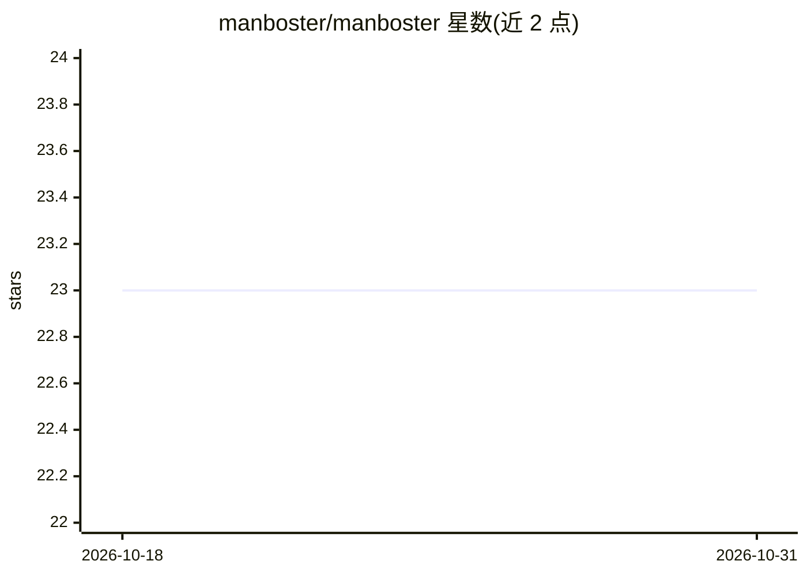

# manboster/manboster

⭐ 23 · Go · Apache-2.0 · 推送 2026-09-26 · [GitHub](https://github.com/manboster/manboster) · [官网](https://manboster.dev) · 个人维护 · 中文 README

**个人 AI 助手：带插件与安全守卫的聊天 agent**

用 Golang 编写的个人 AI 助手，开箱为单可执行文件。支持 Telegram 聊天渠道，LLM 可选 openrouter、kimi、DeepSeek 及 openai 兼容 API。机制上提供 wasm 插件体系、零信任 gatekeeper 与 TTL 管控工具调用、名为 Hachimi 的本地守卫模型评估 LLM 工具调用安全性，以及基于 go-rod 无头浏览器的网页搜索工具。项目自述为 MVP、多项功能（RAG 记忆、MCP 兼容、MamboHub 等）标记为 Work in Progress 或 Planned。

## 筛选速览

| 维度 | 判定 | 备注 |
|---|---|---|
| AI 角色 | `ai-native` | 本体是模型或模型工具 |
| 许可风险 | `permissive` | Apache-2.0 |
| 部署形态 | `library` | 以包/库形式分发 |
| 模型依赖 | — | README 未给出锁定关系 |
| 硬件要求 | — | 无带数字的原话,不猜 |
| 安装摩擦 | `low` | 无编译、无系统依赖或容器化 |
| 成熟度 | `idea` | |

## 能力要点

- 单二进制文件运行，基于 Golang，低内存占用
- Hachimi 本地守卫模型评估工具调用安全性
- 零信任 gatekeeper 系统与 TTL 设置管控工具调用
- 内置 go-rod 无头浏览器网页搜索工具

## 适用场景

- 通过 Telegram 与个人 AI 助手对话
- 以安全受控方式让 LLM 执行工具调用
- 安装 OpenClaw 格式技能与 wasm 插件扩展能力

## 场景标签

`AI 助手` `聊天机器人` · 领域:对话与助手

## 证据(README 行号)

> L11: At the beginning, it is a personal AI assistant which is able to chat with you with ease. However, equipped with wa
> L13: Since this project is work in progress and only shows as a MVP now, there are a few chat options(Telegram and Feish

## 星数曲线

2026-10-18 23 → 2026-10-31 23（+0）

---
*卡片 v1 · prompt 1.4 · 生成 2026-10-27 · 置信度 high · 依据 README sha `ca4fb705a3fd` · [字段定义](../../DATASET.md)*
